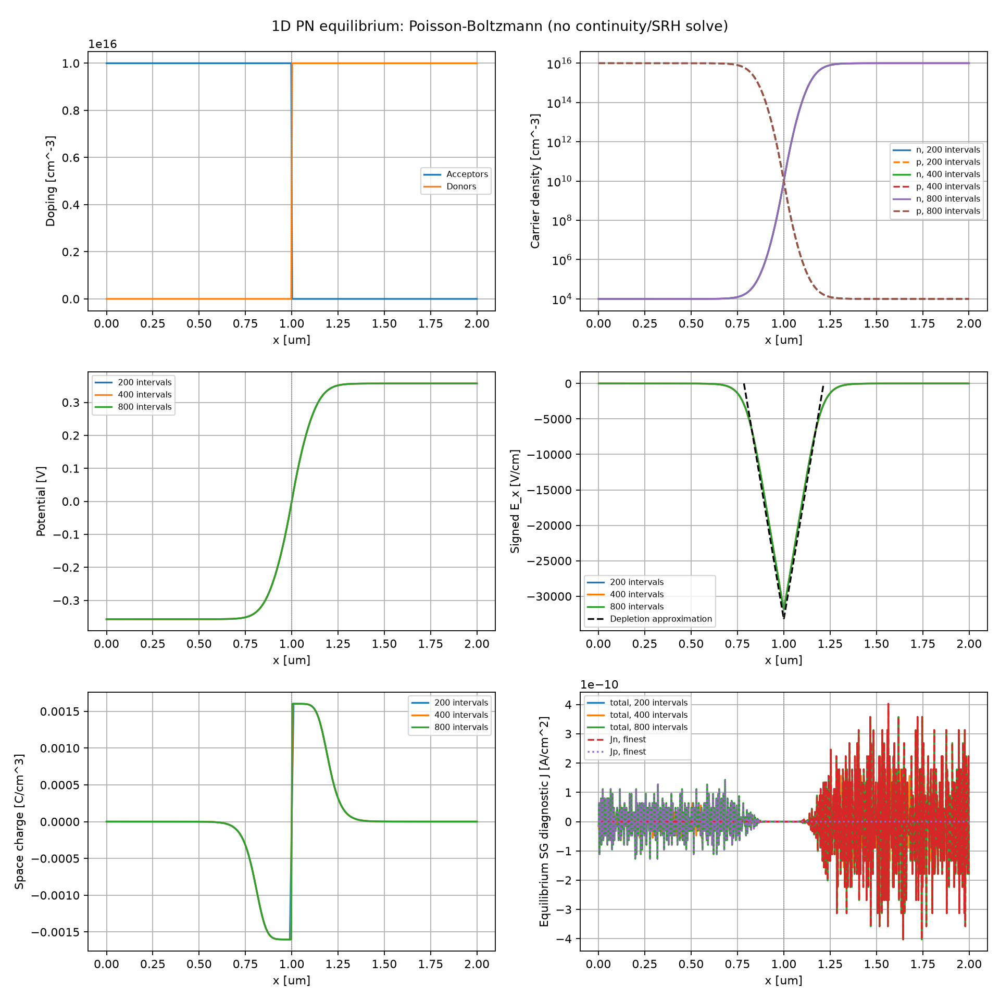
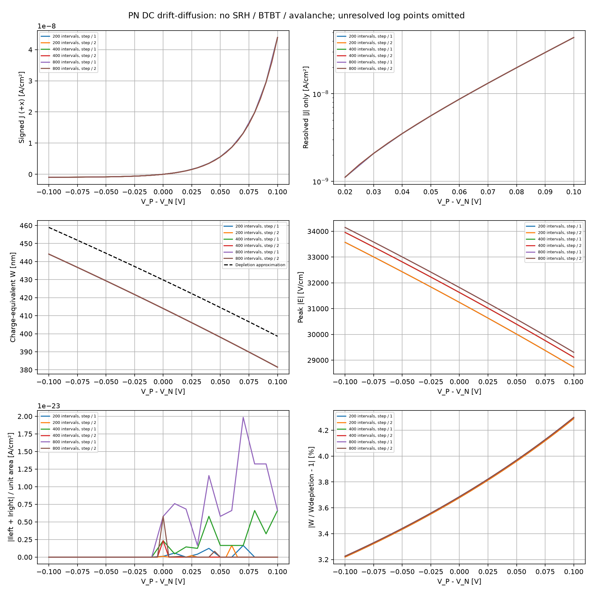
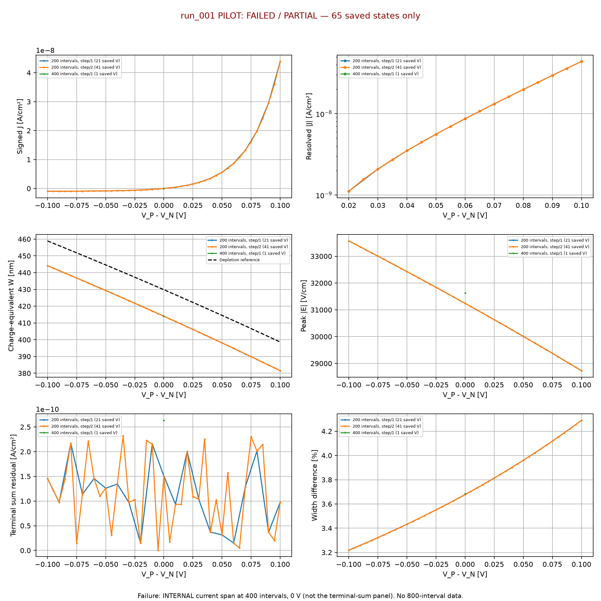
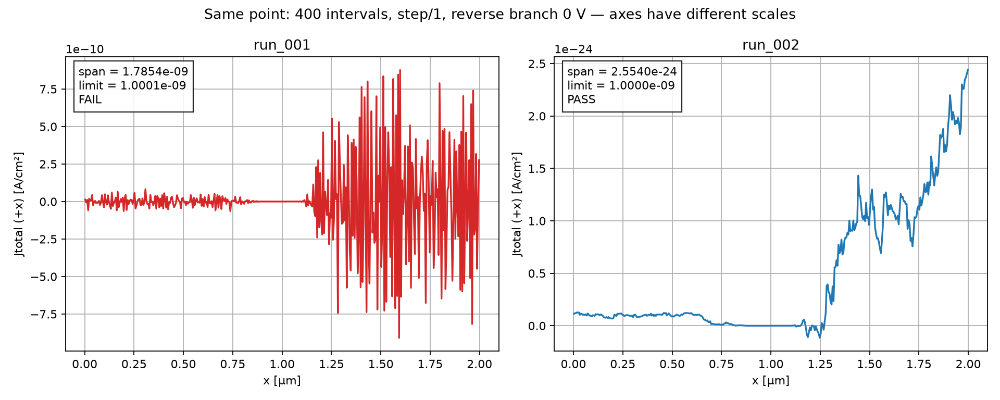
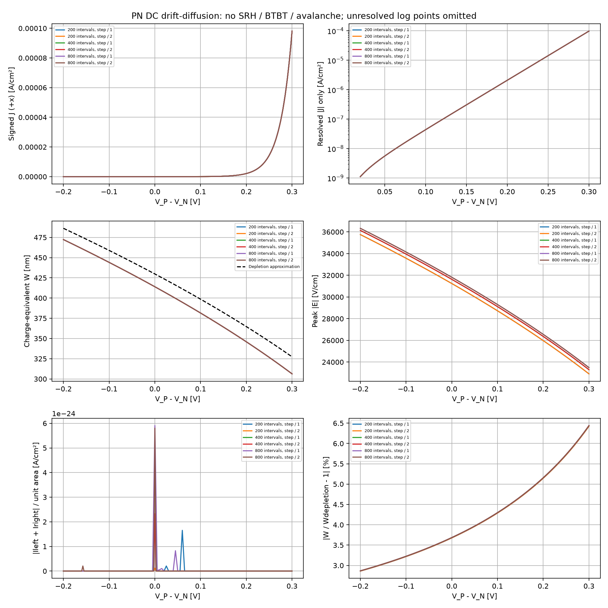
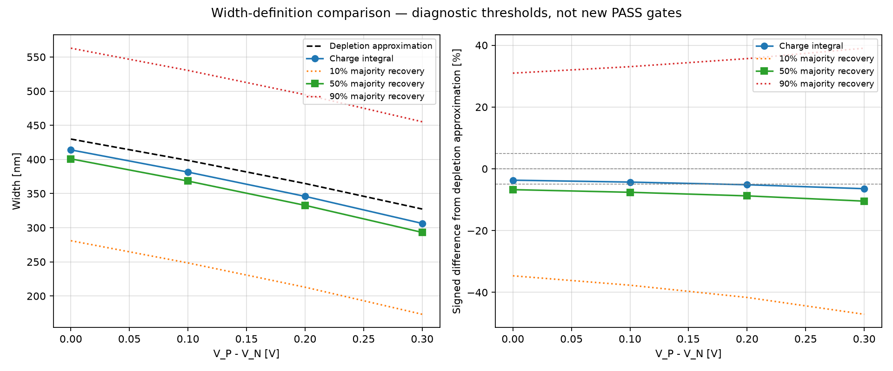
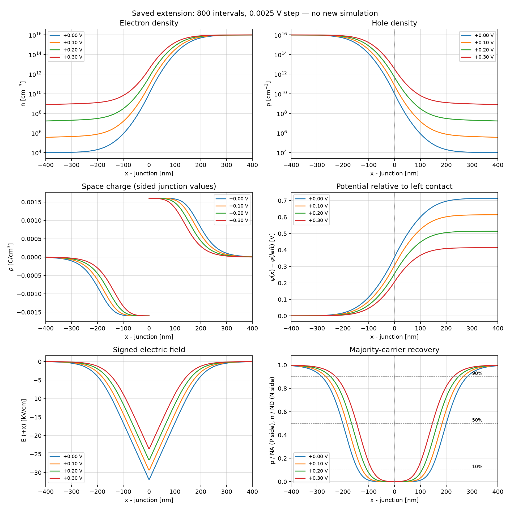

# Phase 1: PN Junction 실행 가이드와 실험 기록

## 1. 범위와 진행 상태

이 문서는 Phase 1의 PN Junction 전용 가이드와 실험 기록이다.
평형 구조 → 바이어스 sweep → SRH 검증 → 고전계 역바이어스·접합 항복 검증을 이 문서에 이어서 기록하고, 이후 MOSCAP으로 진행한다.
[이전 단계: Single/Multi-Layer Capacitor](PHASE1_SIO2_CAPACITOR.md).
실행 가이드와 조건을 먼저 확인하고, 실행 후 결과·그래프·해석·판정은 뒤에 누적한다.
**현재 상태: run_001의 실패 기록을 보존하고, 접합 좌우 적분을 적용한 run_002는 35/35 검증 PASS. 단위·회귀 테스트 9개 통과. 아래 7절은 run_001의 역사적 기록이며 최신 결과는 9절에 기록한다. 사용자 ParaView 화면에서 1D 전계 표시는 확인되었고, 상세 배열 대조는 별도 절차다.**
파일 생성은 모델 검증 완료를 뜻하지 않는다. 아래 허용값을 충족하는지 실행 후 판정하며,
실패 시 임의로 기준을 완화하지 않고 원인·근사 오차·수치 오차를 먼저 분석한다.
**Bias sweep 상태: run_001/pilot은 400구간 0 V 전류 균일성 실패로 중단. 확장 정밀도의 run_002/pilot은 192개 상태·1,842개 검증 PASS, run_001/extension은 912개 상태·8,394개 검증 PASS. 상세 결과는 11~12절, 공간 분포·폭 정의 비교는 13절에 기록한다. 고순방향 공핍 근사 대비 폭 5% 조건은 전 범위에서 충족하지 않는다.**

**최신 상태(2026-10-26): SRH run_001/pilot PASS, run_001/extension FAIL 기록 보존, 전계 추출 개선 후 run_002/extension은 6,168개 상태·97,157개 검증 모두 PASS. 결과와 로그 전류 Figure는 16절에 기록한다. Avalanche 설정·코드·테스트 정의를 준비했고 사전 입력 검사를 완료했다. 실제 단위/회귀/solver 테스트는 아직 실행하지 않았다(17절).**

누설·항복 도입 순서:

1. 평형: Poisson-Boltzmann으로 도핑·내장 전위·공간전하·공핍 근사 검증.
2. Bias sweep: 전자·정공 연속방정식을 결합한 drift-diffusion으로 순/역방향 전류 baseline 검증.
3. SRH: 생성·재결합을 추가하여 역방향 generation current 및 lifetime 민감도 검증.
4. 고전계 역바이어스 확장: impact ionization(avalanche)을 우선 검토·검증하고, 도핑·전계·밴드 조건상 필요하면 BTBT를 독립적으로 검증한다. 역방향 전류밀도의 급증과 생성률 분포를 함께 확인한다. PN 접합 항복이지 산화막 절연파괴가 아니다.
5. Gate tunneling은 MOSCAP에서 장벽 물성과 함께 검증 후 MOSFET에 재사용.
   TDDB/BTI/HCI 수명 연구는 대응 데이터·모델 확보 후 별도 진행한다.

평형에서는 순전류가 거의 0이므로 누설 특성을 측정한 것으로 해석하지 않는다.
평형 및 R=0 baseline은 SRH를 포함하지 않으며, SRH 실험에서는 선택적으로 생성·재결합을 결합한다. 현재까지 검증한 모델에는 BTBT·avalanche·터널링이 없다.

## 2. 파일별 역할과 읽는 순서

| 순서 | 파일 | 역할 |
|---|---|---|
| 1 | configs/phase1/pn_junction.json | 구조·도핑·물성·mesh·오차 기준 |
| 2 | src/device/pn_junction.py | 입력 검증, 해석 기준, 평형 solve, 검증량 추출 |
| 3 | validation/analytic/pn_junction/run_pn_junction.py | mesh/영역크기 비교, CSV·JSON·6패널 PNG, exporter 호출 |
| 4 | validation/analytic/pn_junction/export_vtm.py | 저장 상태를 실제 1D 선 셀의 VTM/VTU로 출력; 재계산 없음 |
| 5 | tests/unit/phase1/test_pn_junction.py | 해석식·입력·SG 계산·합성 VTK 구조 검사 |
| 6 | tests/regression/phase1/test_pn_junction.py | 실제 DEVSIM 및 전체 출력 검증; 실행 시 solve 수행 |

Capacitor 코드와 결과는 변경하지 않는다. PN 소자 파일은 하나이며,
향후 bias sweep을 구현할 때 이 공통 파일을 확장한다. 지금 실행기는 비영 바이어스를 거부한다.

## 3. 초기 파라미터

학습용 Silicon 급격 접합, P/N 각 1000 nm, NA=ND=1e16 cm^-3, 300 K.
ni=1e10 cm^-3, epsilon_r=11.7, mu_n=1350 / mu_p=480 cm²/(V s).
이 값은 일정 물성의 교육용 선택값이며 보정된 공정 데이터가 아니다.
ni는 온도 의존 모델이 아니므로 이 설정으로 temperature sweep의 물리 타당성을 주장하지 않는다.
완전 이온화·비축퇴 통계를 가정한다.

양 접촉의 외부 bias는 0 V이나 내부 electrostatic potential은 서로 다르다.
Vt=kT/q, Vbi=Vt ln(NA ND/ni²),
W=sqrt[(2 epsilon Vbi/q)(1/NA+1/ND)], xp=W ND/(NA+ND), xn=W NA/(NA+ND).
중성 ohmic 접촉 전위는 왼쪽 -Vt asinh(NA/2ni), 오른쪽 +Vt asinh(ND/2ni)이다.
도핑 jump가 위치하는 node에는 양쪽 control volume의 평균 도핑을 두며,
이를 유한 폭의 intrinsic layer가 추가된 것으로 해석하지 않는다.

전체 mesh는 [200,400,800]으로 dx=10/5/2.5 nm이다.
Capacitor의 10 nm 길이와 달리 총 2 µm이므로 기존 구간 수를 기계적으로 복사하지 않는다.
영역 크기 검사는 양측 길이를 2배로 늘리고 1600구간을 사용하여 finest dx를 유지한다.
결과를 보기 전에 정한 기준: Vbi 상대 오차 2%, charge-equivalent W 상대 오차 5%,
mesh/영역 변경 W·peak E 변화 2%, 평형 전류 절대값 1e-6 A/cm².
0 근처 전류를 상대오차로 판정하지 않는다.

## 4. 방정식과 검증 한계

평형 carrier는 n=ni exp(phi/Vt), p=ni²/n이고,
rho=q(p-n+ND-NA), E=-dphi/dx, d(epsilon E)/dx=rho를 푼다.
DEVSIM 2.11의 simple_physics.CreateSiliconPotentialOnly 및 접촉 helper를 사용하며
Permittivity, ElectronCharge, ni, Vt는 JSON 값으로 명시한다.
SetSiliconParameters/CreateSiliconDriftDiffusion 등 SRH 기본값이 들어갈 수 있는 경로는 호출하지 않는다.
참조 구현: DEVSIM LLC, Apache-2.0,
[공식 simple_physics](https://github.com/devsim/devsim/blob/main/python_packages/simple_physics.py).
실행 metadata에는 사용한 설치 helper의 hash도 남긴다.

현재 전류는 평형 n/p/phi에서 Scharfetter-Gummel 식으로 계산한 일관성 지표이다.
독립적인 carrier continuity solve나 접촉 I-V 결과가 아니며 drift/diffusion 개별 전류를 독립 검증한 것도 아니다.
np=ni²와 평탄한 준페르미 준위 역시 모델 관계식에서 유도되는 일관성 확인이다.
Vbi는 접촉 전위차이므로 이것만으로 내부 공간 분포가 맞다고 판정하지 않는다.
공간전하·Gauss 잔차·mesh 및 영역 크기 민감도를 함께 확인한다.

공핍폭은 각 측의 부호 있는 rho 적분의 절댓값을 q*NA 또는 q*ND로 나눈
charge-equivalent xp/xn으로 정의한다. carrier 임계값으로 정의한 경계와 다르다.
공핍 근사와 Boltzmann 수치해의 tail 차이를 근사 오차로 구분한다.
예상과 다른 결과가 나오면 그 차이를 숨기지 않고 실제 기준 충족 여부를 기록한다.

## 5. 실행 명령 (run_001은 이미 생성되어 있으므로 재실행 시 새 run 번호 사용)

```bash
cd /home/iuhj0/projects/Project_Git/tcad_project
# 먼저 함수·입력·exporter 단위 테스트
.venv/bin/python -B -m unittest tests.unit.phase1.test_pn_junction -v
# 실제 solve 및 출력 회귀 테스트 (임시 폴더)
.venv/bin/python -B -m unittest tests.regression.phase1.test_pn_junction -v
# 검토/테스트 후 보관용 실험
.venv/bin/python -B -m validation.analytic.pn_junction.run_pn_junction \
  --config configs/phase1/pn_junction.json \
  --output data/raw/phase1/pn_junction_structure/run_001
```

생성된 출력: config.json, metadata.json, mesh_200/400/800.json, domain_check.json,
metrics.csv, validation.csv, profiles.csv, edges.csv, summary.json,
pn_junction.png, pn_junction.vtm, pn_junction.vtu.
profiles/edges는 finest baseline의 node/edge값이고 metrics는 3 mesh와 확대 영역의 요약이다.
각 mesh JSON의 solver_info에 수렴·iteration 기록을 보관한다.
실패 시 FAIL/ERROR 상태 및 필요 시 error.txt를 보존하고 기존 run은 덮어쓰지 않는다.
PNG는 도핑 → n/p → 전위 → 전계 → 공간전하 → 평형 전류의 3×2 구성이다.

## 6. ParaView 첫 검증

동일 finest baseline JSON에서 표준 VTK XML의 실제 VTK_LINE 셀을 출력한다.
1D를 가짜 2D 막대로 확장하지 않으며, native exporter의 지원 여부에 의존하지 않는다.
좌표는 cm, field 이름에 단위를 붙이고 node 값은 PointData,
전계·전류 edge 값은 CellData로 보존하여 계면 보간을 피한다.
Python XML 기반이며 vtk 패키지를 추가 설치하지 않는다.

VTM은 같은 위치의 VTU를 상대경로로 참조하므로 두 파일을 함께 이동한다.
최초 실행 후 ParaView에서 선 mesh, node/cell 개수, 단위, 배열값 및 CSV와의 일치를 확인한다.
XML 구조 테스트 및 실제 VTU의 801 node/800 cell, 모든 PointData/CellData와 mesh_800.json의 정확한 일치를 확인했다. ParaView GUI 읽기는 아직 검증되지 않았다.
그래프의 평형 전류를 누설 I-V로 해석하지 않는다.

## 7. 실험 결과 기록

### 7.1 질문

대칭 급격 PN 접합의 평형 전위·캐리어·전계·공간전하가 이론 및 mesh/영역 크기 검증을 만족하는가?

### 7.2 예상과 계산 과정

길이 cm, 농도 cm^-3, 유전율 F/cm를 사용한다.

1. Vt=kT/q=0.02585199979 V.
2. epsilon=11.7×8.8541878128e-14=1.0359399741e-12 F/cm.
3. 중성 영역 다수 캐리어≈1e16, 소수 캐리어=ni²/N≈1e4 cm^-3.
4. n=ni exp(phi/Vt)와 양측 중성 조건에서 Vbi=Vt ln(NA ND/ni²)=0.714317152 V.
5. 공핍 근사 rho_P=-qNA, rho_N=+qND를 dE/dx=rho/epsilon에 넣어 적분하면 전계는 삼각형이다.
6. NA xp=ND xn 및 Vbi=|Emax|W/2를 결합하면 W=sqrt[2epsilon Vbi/q×(1/NA+1/ND)]=429.821004 nm.
7. xp=xn=214.910502 nm, Emax=-2Vbi/W=-33237.8895 V/cm. +x가 P→N이므로 전계는 음수다.
8. 공핍 근사 |rho|=qN=1.602176634e-3 C/cm³, 중성 영역 rho≈0이다.

접합은 x=1000 nm, 공핍 근사 경계는 785.089498/1214.910502 nm이다. 접촉 전위는 -0.357158576/+0.357158576 V다. 외부 bias=0과 내부 내장 전위는 다르다.

### 7.3 조건과 코드

입력 [pn_junction.json](../configs/phase1/pn_junction.json), 소자 [pn_junction.py](../src/device/pn_junction.py), 실행·그림 [run_pn_junction.py](../validation/analytic/pn_junction/run_pn_junction.py), VTK [export_vtm.py](../validation/analytic/pn_junction/export_vtm.py)를 사용했다.
P/N 각 1000 nm, NA=ND=1e16 cm^-3, 300 K, mesh 200/400/800이다. 영역 검사는 각 2000 nm·1600구간으로 dx를 유지했다.

초기 solve는 전위 0 근처의 상대 업데이트 수렴 판정에 걸렸다. 허용 오차를 바꾸지 않고 내부 미지수를 U=phi+g, g=Vbi+Vt로 이동했다. Boltzmann 지수도 (U-g)/Vt로, 접촉 기준도 g만큼 함께 이동하고 출력에서는 g를 뺐다. 이는 물리적 bias·전계·농도를 바꾸는 전압 인가가 아니다. 수정 후 4개 solve 모두 수렴했다. PN 코드에만 적용했으며 capacitor는 변경하지 않았다.

핵심 수식 구현:

```python
field = [-(b-a)/(xr-xl) for a,b,xl,xr in zip(potential,potential[1:],x,x[1:])]
# 공간전하: q*(p-n+ND-NA)
rho = [q*(h-e+d-a) for h,e,d,a in zip(p,n,nd,na)]
# left/right는 각 측 rho의 사다리꼴 적분
xp = abs(left)/(q*c['acceptors_cm3'])
xn = abs(right)/(q*c['donors_cm3'])
```

전계는 node 전위의 차분이며, 전하등가 폭은 carrier 임계 농도로 정한 경계와 다르다.

### 7.4 결과

저장 위치: [run_001](../data/raw/phase1/pn_junction_structure/run_001). Windows와 WSL 양쪽에 보관했다.
근거는 metrics.csv와 validation.csv이며 재실행 시 덮어쓰지 않는다.

| 경우 | dx (nm) | Vbi (V) | 전하등가 W (nm) | 공핍 근사 대비 W 오차 | 최대 전계 크기 (V/cm) |
|---|---:|---:|---:|---:|---:|
| 200구간 | 10 | 0.714317152 | 404.013393 | 6.00427% — 실패 | 31242.1972 |
| 400구간 | 5 | 0.714317152 | 408.983197 | 4.84802% | 31626.5102 |
| 800구간 | 2.5 | 0.714317152 | 411.475648 | 4.26814% | 31819.2504 |
| 영역 2배·1600구간 | 2.5 | 0.714317152 | 411.475648 | 4.26814% | 31819.2504 |

400→800의 W/peak E 상대 변화≈0.606%, 영역 2배 시 W 상대 변화≈9.96e-10이다.
800구간 최대 |Jtotal|=4.026e-10 A/cm² (기준 1e-6), Gauss 잔차=4.659e-22 C/cm² (기준 1e-12), np 상대 오차=2.22e-16이다.
단위 테스트 5개 통과. 회귀 테스트 2개는 동일한 200구간 W 기준 실패로 실패했다. 실험은 35개 중 34개 통과, metadata.status=FAIL이다.

### 7.5 Figure 해석



1. 좌상 도핑: 1 µm에서 P/N 전환. 고정 도핑과 이동 carrier 농도는 다르다.
2. 우상 n/p: P측 p≈1e16/n≈1e4, N측은 반대. 중심 n=p≈ni=1e10이며 분포는 연속이다.
3. 좌중 전위: 중성 영역은 평탄, 접합에서 상승. 전체 차는 0.714317 V다.
4. 우중 전계: 음의 전계가 접합에서 최대. 공핍 근사 삼각형과 수치해의 둥근 경계/tail 차이에는 이동 캐리어를 포함하는 모델과 공핍 근사의 차이가 들어간다.
5. 좌하 공간전하: P측 음/N측 양, 중성 영역≈0. 접합 node 평균 도핑으로 중심이 연결되며 가짜 intrinsic 층이 아니다.
6. 우하 전류: 약 1e-10 A/cm²의 진동은 SG 계산의 큰 항 상쇄·반올림 영향을 받는 평형 잔차다. 누설전류/항복 신호가 아니다. 작은 dx에서 잔차가 증가해도 이 크기만으로 물리적 불안정을 뜻하지 않는다.

### 7.6 판정과 한계

전체 PASS가 아니다. coarse mesh 6.0% 오차에는 접합 node 평균/적분 이산화와 공핍 근사의 모델 차이가 함께 들어간다. 800구간에서 남은 4.27%를 모두 mesh 오차라고 단정하지 않는다.
다음은 추가 mesh 수렴과 전하 적분 정의 검토로 실패 원인을 분리하는 것이다. 기준을 사후 완화하거나 실패 run을 지우지 않는다. 평형 검증을 정리한 뒤 continuity를 포함한 bias sweep으로 진행한다.

## 8. ParaView 실행 절차

1. run_001/pn_junction.vtm을 File → Open → Apply로 연다. 같은 폴더의 pn_junction.vtu가 반드시 함께 있어야 한다.
2. Reset Camera 후 선이 가늘면 Line Width를 늘린다. 1D 선만 보이는 것이 정상이다.
3. Information에서 801 points/800 line cells, x=0~2e-4 cm를 확인한다. GUI 읽기는 사용자 환경에서 확인해야 한다.
4. PointData에서 Potential_V, Electrons_cm3, Holes_cm3, ChargeDensity_C_per_cm3를 선택한다. 양수 n/p는 log scale 가능하지만 부호가 있는 rho/E에는 사용하지 않는다.
5. CellData의 ElectricField_V_per_cm로 음의 전계를 확인한다. Spreadsheet View에서 PointData는 profiles.csv, CellData는 edges.csv와 대조한다.
6. 정량 곡선은 Plot Data에서 X Array=x_cm, Y=원하는 배열을 선택한다. 필요 시 Silicon_PN 블록을 선택/추출한다. x(cm)×1e4가 Figure의 µm다.
7. CellData→PointData 변환이나 Plot Over Line 재표본화는 보간 결과다. 초기 검증은 Spreadsheet View의 원시 배열을 기준으로 한다.

공식 참고: [ParaView plotting](https://docs.paraview.org/en/v5.13.3/Tutorials/ClassroomTutorials/beginningPlotting.html), [data display](https://docs.paraview.org/en/latest/UsersGuide/displayingData.html).

## 9. run_002: 접합 좌우 전하 적분 검증

### 9.1 질문·예상

접합 node의 solver용 평균 도핑을 양측 적분 끝점으로 사용하던 방식 대신, 급격 접합의 좌우 극한값을 사용하면 공핍폭 추출이 mesh에 안정적인가?
기존에도 사다리꼴 적분을 사용했다. 새 방식은 적분 끝점의 물리적 정의를 수정하는 것이며 소자 최적화나 허용 오차 조정이 아니다.

### 9.2 조건·구현

device 파일은 src/device/pn_junction.py 하나만 유지한다.
기존 assess(config,state)는 legacy 방식으로 보존하고, assess_interface(config,state)와 interface_side_charges(config,state)를 추가했다.
접합에서 계산된 p_j,n_j를 그대로 사용하여 rho_left=q*(p_j-n_j-NA), rho_right=q*(p_j-n_j+ND)를 각 측 사다리꼴 적분에 적용한다. 단순히 W에 dx를 더하는 보정식을 넣지 않는다.
원시 node/edge, solver, 도핑, mesh, 물성, 검증 허용 오차 및 Gauss 잔차 계산은 변경하지 않았다. 이 방식의 전하등가 폭은 연속적인 구간별 전하 적분이며 solver의 평균-node 이산량과 구분한다.
실행기의 기본 평가 방식은 legacy로 유지하고, 선택한 방식을 metadata/summary에 명시한다.

```bash
cd /home/iuhj0/projects/Project_Git/tcad_project
.venv/bin/python -B -m unittest tests.unit.phase1.test_pn_junction tests.regression.phase1.test_pn_junction -v
.venv/bin/python -B -m validation.analytic.pn_junction.run_pn_junction \
  --config configs/phase1/pn_junction.json \
  --assessment interface_sided \
  --output data/raw/phase1/pn_junction_structure/run_002
```

위 run_002는 이미 실행되어 있다. 재실행은 새 run 번호를 사용한다. --assessment legacy로 이전 평가 방식을 선택할 수 있다.

### 9.3 결과

| Mesh | run_001 W (nm) | run_002 W (nm) | run_002 공핍 근사 대비 오차 |
|---|---:|---:|---:|
| 200 | 404.013393 | 414.013393 | 약 3.678% |
| 400 | 408.983197 | 413.983197 | 약 3.685% |
| 800 | 411.475648 | 413.975648 | 약 3.687% |

4회 solve 수렴, 35개 검증 모두 통과했다. 단위 테스트 7개 및 회귀 테스트 2개도 통과했다.
추가 단위 테스트는 비대칭 도핑·비균일 간격, 이동 캐리어의 접합 전하 기여, 입력 상태 비변경, 접합 node 누락 거부를 확인한다. 회귀 테스트는 legacy의 200구간 실패와 기존 공핍폭도 계속 확인한다.

### 9.4 해석·판정과 보존

5% 허용 오차를 변경하지 않고 통과했다. 약 3.69%의 남은 차이는 공핍 근사와 Poisson–Boltzmann 전하등가 폭의 차이를 포함한다. PASS는 최적 소자나 비평형 모델 검증 완료를 뜻하지 않는다.
Windows와 WSL의 run_001 14개 파일은 SHA-256 검사로 변경 없음을 확인했다. run_002는 별도 폴더로 저장했다.
run_001과 run_002 사이 config.json, profiles.csv, edges.csv, pn_junction.png, pn_junction.vtm, pn_junction.vtu는 파일 해시까지 동일하다. 따라서 6패널 Figure와 ParaView 원시 물리량은 변하지 않았다. 새 run의 metrics/validation 및 평가 방식 기록이 바뀐다.
기존 metadata의 소스 해시는 과거 실행 기록이므로 현재 코드 해시로 덮어쓰지 않는다.

## 10. PN Voltage Sweep 실행 가이드

### 10.1 질문과 진행 순서

평형 검증 이후, 외부 전압에 따른 DC 전류·전하등가 공핍폭·전계 변화를 검증한다. 실행 결과는 11절에 분리하여 기록한다.
먼저 코드 검토 → 단위 테스트 → 0/±0.01 V 실제 DD 회귀 테스트 → pilot → 결과 검토 → extension 순으로 진행한다. SRH는 이후 독립 검증 단계이며 이번에는 R=G=0이다.
device는 기존 src/device/pn_junction.py 하나를 유지한다. 평형 simulate/assess/assess_interface와 기존 run은 보존한다.

### 10.2 파라미터·바이어스 규약

새 설정은 [pn_junction_voltage.json](../configs/phase1/pn_junction_voltage.json)이다. base_config는 같은 폴더의 pn_junction.json을 가리킨다. geometry·도핑·물성·mesh [200,400,800]을 재사용하고, 실행 시 두 설정을 하나의 config.json snapshot에 저장한다. 기존 JSON을 덮어쓰지 않는다.

**V_A=V_P−V_N**, 왼쪽 P 접촉에 V_A, 오른쪽 N 접촉에 0 V를 인가한다. 양수가 순방향이다. Capacitor에서 사용한 Vright−Vleft와 혼동하지 않는다. 내부 gauge는 수치 기준점이며 외부 인가전압과 구분한다.

| 단계 | 역방향 branch | 순방향 branch | 중복 0 제외 기본 전압 수 |
|---|---|---|---:|
| pilot | 0→−0.10 V, −0.01 V 간격 | 0→+0.10 V, +0.01 V 간격 | 21 |
| extension | 0→−0.20 V, 0.005 V 간격 | 0→+0.30 V, 0.005 V 간격 | 101 |

각 branch는 11점 이상이며, step_refinements=[1,2]로 절반 간격을 독립 재계산한다. pilot의 세밀 격자는 중복 0 제외 41점이다. extension은 전 범위에 기본 간격 0.005 V를 적용하며 역방향 41점·순방향 61점, 중복 0 제외 101점이다. 절반 간격 0.0025 V에서는 역방향 81점·순방향 121점, 중복 0 제외 201점이다. 두 방향은 각각 평형에서 출발하므로 0 V는 두 번 계산하여 일치 여부를 확인한다. 단계마다 모든 mesh를 비교한다.
extension은 전체 전압 범위에서 균일하고 세밀한 데이터를 확보하도록 구성한다. 촘촘한 표본이 물리 모델의 정확성이나 수렴 성공을 보장하지는 않으므로 mesh/half-step 검증을 함께 수행한다.
이 범위는 최초 검증용 제한 범위이며 소자 최대 동작 범위나 항복 범위가 아니다. extension은 같은 설정·소스 해시의 PASS pilot을 --pilot-run으로 지정해야 실행할 수 있다. 자동으로 extension으로 넘어가지 않는다.

### 10.3 방정식과 Width 추출

Poisson: d(epsilon E)/dx=q(p−n+ND−NA), E=−dphi/dx.
전자/정공 연속방정식: DC, R=G=0에서 dJn/dx=dJp/dx=0.
Jn=q*mu_n*n*E+q*Dn*dn/dx, Jp=q*mu_p*p*E−q*Dp*dp/dx, D=mu*Vt.
전류 이산화는 설치된 DEVSIM simple_dd의 Scharfetter–Gummel 모델 및 Jacobian을 사용한다. SRH를 자동 생성하는 CreateSiliconDriftDiffusion은 호출하지 않고 CreatePE/CreateECE/CreateHCE를 개별 구성하며 generation 모델은 명시적으로 0이다.
이상적 ohmic 접촉에서 n/p는 해당 도핑의 중성 평형 농도로 고정하고 전위 경계에 외부 전압을 더한다. 비평형의 내부 n,p는 각각 독립 미지수이며 n=ni*exp(phi/Vt)를 강제하지 않는다. 따라서 np=ni²나 준페르미 전위 평탄성을 비영 bias의 PASS 조건으로 사용하지 않는다.

바이어스 공핍 근사 기준:

```text
W_ref(V_A) = sqrt[(2 epsilon/q)(Vbi−V_A)(1/NA+1/ND)]
V_A < 0: Vbi+|V_A|로 공핍폭 증가
V_A > 0: Vbi−V_A로 공핍폭 감소 (근사 유효 범위 내)
```

수치 추출은 run_002에서 검증한 interface_side_charges를 그대로 재사용한다.

```python
left, right = interface_side_charges(config, state)
width = abs(left)/(q*config['acceptors_cm3']) + abs(right)/(q*config['donors_cm3'])
```

접합의 rho_left=q*(p_j−n_j−NA), rho_right=q*(p_j−n_j+ND)를 사용하며, 비평형에서도 p_j=n_j라고 가정하지 않는다. 이 값은 전하등가 폭이지 carrier 임계값 기반의 기하학적 공핍 경계가 아니다.
순방향에서 중성 영역 전압 강하·주입이 커지면 외부 전압 전체를 접합 장벽 변화로 보는 근사가 나빠진다. 공핍 근사 대비 5% gate는 V_A≤0.10 V에만 설정한다. 더 큰 순방향에서는 차이를 그대로 출력하되 그 근사식 일치로 PASS를 강요하지 않는다. gate 적용 여부도 iv.csv에 저장한다. 실제 pilot이 이를 만족한다는 주장은 아직 하지 않는다.

### 10.4 수렴 및 판정 준비

- 각 mesh/방향/step은 기존 평형 해로 초기화한 뒤 0 V에서 coupled DD를 solve한다.
- 다음 전압은 직전 수렴 해로 시작한다. 실패하면 세 미지수 Potential/Electrons/Holes와 접촉 bias를 복원하고 중간 전압을 삽입한다.
- 최소 내부 step 0.0003125 V, 최대 이분 깊이 6. 한도 초과 시 중단한다. 중간점은 요청 grid점 수를 대신하지 않으며 시도 내역을 convergence.jsonl에 기록한다.
- 첫 실패 검증점에서 멈추고 부분 JSON/CSV와 error.txt를 남긴다. 실패값을 0으로 대체하거나 건너뛰고 PASS로 표시하지 않는다.
- DD solver_absolute_error=1e6은 밀도까지 포함하는 혼합 미지수 업데이트 기준이다. 평형의 전위-only 1e-12와 단위가 같은 전류/전위 정확도 기준으로 비교하지 않는다. relative_error=1e-10을 병행하고 전위 경계 1e-8 V, 전류 및 Gauss 검사를 별도로 수행한다. 실행 전 검토용 설정이며 수렴 입증값이 아니다.
- 전류 보존: 절대 허용 1e-9 A/cm² + 상대 1e-4×전류 크기. 초기 평형 SG 잔차를 참고한 pilot 기준이며 실제 DD zero-bias 바닥을 검토해야 한다. 그보다 작은 역전류는 unresolved로 표시한다.
- 원시 contact 전류 부호를 보존하고, 양 접촉 합과 edge +x 전류 크기의 일치를 검사한다. 1D 단위 단면적 기준이며 실제 소자 면적의 A값으로 오인하지 않는다. edge 전류 부호와 인가전압의 관계도 분해 가능한 비영 전류에서 검사한다.
- mesh/half-step 비교: 전류는 위 절대 바닥+2% 상대 기준, W/peak E는 2% 상대 기준. 양 방향 0 V 재초기화도 비교한다.
- 유한·양수 carrier, 전위 경계, 이산 Gauss 검증을 포함한다. 모델이 없으므로 실제 SRH 누설·항복·신뢰성을 입증하지 않는다.
- 평형의 영역 크기 검증만으로 비평형 수송의 contact/영역 크기 독립성을 주장하지 않는다. R=0에서 long-base Shockley 포화전류 공식을 무조건 기준으로 사용하지 않는다.

### 10.5 파일과 예정 출력

| 파일 | 역할 |
|---|---|
| configs/phase1/pn_junction_voltage.json | 조건·단계·step·허용값 |
| src/device/pn_junction.py | 기존 평형 + bias_reference/bias_grid/validate_bias/assess_bias/simulate_bias_branch |
| validation/analytic/pn_junction/run_voltage.py | 실행·검증·CSV·6패널 PNG, 기존 exporter 호출 |
| tests/unit/phase1/test_pn_voltage.py | grid·중복·step 포함관계·이론 폭 검증 정의 |
| tests/regression/phase1/test_pn_voltage.py | 0/±0.01 V DD와 평형 폭 비교 정의 |
| docs/PHASE1_PN_JUNCTION.md | 본 소자의 단일 가이드·실험 기록 |

주제 폴더는 data/raw/phase1/pn_junction_voltage_sweep/ 하나다. 각 run 아래 pilot/과 extension/을 구분한다. 실패 수정 재실행은 해당 단계의 새 run 번호로 저장한다. Extension의 첫 실행은 사용자 지시에 따라 run_001/extension에 저장하고, 선행 검증은 --pilot-run으로 명시한 run_002/pilot을 참조한다. 따라서 같은 run 번호의 pilot과 extension이 반드시 같은 설정이라는 뜻은 아니며 각 config.json과 metadata.json을 확인한다. 미실행 extension 폴더를 결과처럼 생성하지 않는다.
실행 후 config.json, metadata.json, iv.csv, validation.csv, convergence.jsonl, summary.json, voltage.png 및 mesh/step/방향/point별 JSON을 저장한다. 미완료 시 partial 결과와 오류를 보존한다.
iv.csv는 모든 요청 bias의 J/W/E·전류 보존·근사 차이·noise-floor 여부·state 파일명을 담는다. validation.csv는 점별 검증과 mesh/half-step 비교 판정이다. 공간 프로파일은 각 state JSON의 nodes/edges에 있으며 독립 VTK exporter도 같은 JSON을 읽는다.
최세밀 mesh·half-step의 명시한 대표 bias에만 VTM/VTU를 함께 생성한다. 기존 export_vtm.py를 재사용하고 새 ParaView 폴더를 만들지 않는다. 순서 인덱스는 과도 시간이 아니다.

예정 Figure는 좌→우, 위→아래: (1) signed J–V, (2) 분해 가능한 |J| 로그, (3) W_Q와 W_ref, (4) peak |E|, (5) terminal 전류 합 잔차, (6) W 공핍 근사 상대 차이다. log 그래프에서 0/미분해 값을 floor로 꾸미지 않고 제외하며 원시값은 CSV에 남긴다.

### 10.6 실행 명령

```bash
cd /home/iuhj0/projects/Project_Git/tcad_project
.venv/bin/python -B -m unittest tests.unit.phase1.test_pn_junction tests.unit.phase1.test_pn_voltage -v
.venv/bin/python -B -m unittest tests.regression.phase1.test_pn_junction tests.regression.phase1.test_pn_voltage -v
.venv/bin/python -B -m validation.analytic.pn_junction.run_voltage \
  --config configs/phase1/pn_junction_voltage.json --stage pilot \
  --output data/raw/phase1/pn_junction_voltage_sweep/run_001/pilot
# pilot PASS 및 실제 그래프·전류 부호·바닥 검토 이후에만:
.venv/bin/python -B -m validation.analytic.pn_junction.run_voltage \
  --config configs/phase1/pn_junction_voltage.json --stage extension \
  --pilot-run data/raw/phase1/pn_junction_voltage_sweep/run_002/pilot \
  --output data/raw/phase1/pn_junction_voltage_sweep/run_001/extension
```

기존 결과 폴더는 덮어쓰지 않는다. Extension 실행 기록은 12절에 정리한다. commit/push는 이번 작업에 포함하지 않는다.

## 11. Pilot 실행 및 Figure 분석

### 11.1 질문·예상·조건

질문: 작은 순/역방향 전압에서 DC 수송, 전류 보존, 공핍폭 및 전계가 일관적인가?
예상: V_P−V_N가 양수면 순방향 전류 증가와 W/peak E 감소, 음수면 공핍폭/전계 증가. SRH·BTBT·avalanche는 포함하지 않는다.
조건: −0.10~+0.10 V, 기본 0.01 V 및 절반 0.005 V, mesh 200/400/800. 방향별 0 V를 각각 계산하므로 총 요청 상태는 3×(22+42)=192개다. 서로 다른 192개 전압이라는 뜻이 아니다.

### 11.2 run_001/pilot 실패와 수정

사전 테스트 13개 통과 후 실제 sweep은 65개 상태까지 저장하고 400구간·기본 step·역방향 시작 0 V에서 중단했다.
edge_total_current_uniformity=1.7854426455e-9 A/cm²가 limit=1.0000908745e-9를 초과했다. 해당 점의 전류 범위는 −9.08745e-10~+8.76697e-10 A/cm²다.
summary는 INCOMPLETE, metadata는 ERROR이며 validation.csv에 False 1개가 남아 있다. 최초 실행은 PNG 생성 단계 이전에 중단됐다. 이후 11.6절에서 저장된 부분 데이터만으로 FAILED/PARTIAL 표시가 있는 voltage.png를 추가했다. 원래 실패 판정과 CSV/JSON은 변경하지 않았다.

영전류에서 SG의 큰 항 상쇄 오차를 줄이기 위해 DEVSIM의 extended_solver/extended_model/extended_equation을 활성화했다. 물리 모델, 적분식, mesh, 전압 범위, 허용값을 변경하지 않았다. precision 설정은 branch 시작 전에 적용하고 종료 시 기존 유효값을 복원하여 다른 소자의 실행에 남지 않게 했다.
설정 JSON에 extended_precision=true로 기록한다. 기존 run_001 snapshot은 확장 정밀도 이전 조건으로 보존한다. 공식 근거: [DEVSIM extended precision](https://devsim.net/solver.html#extended-precision).

### 11.3 run_002/pilot 결과

192개 요청 상태 완료, 1,842개 검증 PASS, 실패 0개. 수정 후 전체 PN 단위·회귀 테스트 13개 통과.
Windows와 WSL에 실패/성공 run을 모두 보존했다. 원래 평형 pn_junction_structure의 결과는 변경하지 않았다.

| V_P−V_N | J (A/cm²) | W_Q (nm) | 최대 전계 크기 (V/cm) | 공핍 근사 대비 W 차이 |
|---|---:|---:|---:|---:|
| −0.10 V | −9.53987e-10 | 444.116 | 34150.001 | 3.226% |
| 0 V | 약 −7.5e-25 | 413.976 | 31819.250 | 3.687% |
| +0.10 V | +4.38856e-8 | 381.461 | 29304.924 | 4.300% |

표는 mesh 800·half-step 결과이며 CSV의 모든 유효 숫자를 물리적 정확도로 해석하지 않는다.
최대 접촉 전류 합 잔차=1.98523e-23 A/cm², 전체 점의 최대 edge 전류 폭=3.30872e-23 A/cm², Gauss 잔차 최대=1.93160e-24 C/cm²이다. 반올림 출력에서 일부 잔차는 0으로 기록되며 물리적으로 정확한 무오차를 뜻하지 않는다.

### 11.4 Figure 6개 해석



1. 좌상 signed J–V: 순방향 증가가 뚜렷하며 역방향은 작은 음수다. +0.10 V에서 약 4.39e-8 A/cm². 곡선 6개가 거의 겹친다. 실제 제조 소자의 누설/항복 특성이 아니라 R=0 모델의 결과다.
2. 우상 log |J|: 설정 바닥 1e-9 A/cm²를 넘는 약 +0.02~+0.10 V만 보인다. 역방향과 작은 순방향을 0으로 바꾼 것이 아니라 제외한 것이다. 확장 정밀도로 잔차가 작아져도 최초의 바닥 기준은 사후 변경하지 않았다. 직선에 가까운 경향만으로 이상계수=1을 입증하지 않는다.
3. 좌중 W–V: 역방향에서 444.12 nm, 평형 413.98 nm, 순방향에서 381.46 nm로 감소한다. run_002 평형에서 사용한 좌우 적분을 그대로 사용한다. 검은 점선은 공핍 근사이며 이동 캐리어를 포함한 수치해와 차이가 있다.
4. 우중 peak |E|: 순방향으로 갈수록 감소한다. mesh별 선이 나뉘는 이유는 접합 peak가 node 사이 edge 위치에서 표본화되기 때문이다. +0.10 V에서 200/400/800구간은 28728.12/29112.23/29304.92 V/cm다. half-step 선은 거의 겹치고 인접 mesh 비교는 2% 기준을 통과한다.
5. 좌하 전류 보존: 세로축 1e-23에 주의한다. 작은 수치 잔차를 확대해서 들쭉날쭉 보이는 것이며 물리적 잡음·누설 증가가 아니다. 확장 정밀도에서 Python float로 추출하며 생기는 반올림도 포함한다.
6. 우하 W 상대 차이: 약 3.23→4.30%로 증가하며 모두 5% 이내다. 순방향에서 공핍 근사와 차이가 커지는 경향을 보여주며 mesh 오차만을 뜻하지 않는다.

### 11.5 판정·한계와 다음 단계

Pilot의 정의된 수치 검증은 PASS다. 역전류는 현 기준에서 unresolved이며, 작은 전류의 물리적 예측 정확성을 입증하지 않는다. biased domain/contact 민감도와 R=0 short-base 한계는 남는다.
대표 VTK는 mesh 800·half-step의 0 V(두 branch), −0.10 V, +0.10 V에서 생성됐다. 해당 JSON과 같은 수렴 상태이며 파일 이름의 point index는 시간이 아니다.
Pilot 완료 당시 Extension은 미실행이었다. 이후 사용자 승인에 따른 첫 Extension 실행은 12절에 기록한다. run_001/pilot은 실패 증거로 유지하며, Extension 이후에는 SRH 모델을 독립적으로 검증한다.

### 11.6 실패 행 위치와 저장 데이터 기반 Figure 대조

run_001/pilot/validation.csv의 헤더 포함 417행(416번째 데이터 행)이 유일한 False다.

```text
reverse,400,1,0.0,edge_total_current_uniformity,1.785442645528076e-09,1.0000908745251118e-09,False
```

같은 상태의 대표값은 iv.csv 66행(65번째 데이터 행), 원시 배열은 mesh_400_step_1_reverse_000.json이다. solver는 converged=True이나 물리량 검증 실패로 다음 점 진행을 중단한 것이다. run_002의 같은 validation.csv 417행은 True다.
실패 지표는 max_x Jtotal−min_x Jtotal이며, 기존 6패널의 좌하에 있는 |Ileft+Iright|와 다르다. 해당 점의 접촉 합 잔차 2.63328e-10은 통과하지만 내부 전류 폭 1.78544e-9는 실패한다. 내부의 양/음 수치 오차가 평균에서 상쇄되어 mean J=-2.32266e-13만 보면 문제를 놓칠 수 있다.

validation/analytic/pn_junction/review_pilot.py는 solver를 호출하지 않고 두 run의 CSV/JSON을 읽어 대조한다. 동일 mesh/step/branch/bias인 65개 저장 상태만 비교했다. 실패 run에는 200구간 64개 상태와 400구간 0 V 한 점만 있으며 800구간 데이터는 없다.
기존 279개 파일은 후처리 전후 SHA-256 일치를 확인했다. 신규 파일은 run_001/pilot/voltage.png, figures/pn_pilot_current_uniformity.png, figures/pn_pilot_comparison.json이다.




| 동일 실패 조건: 400구간, step/1, reverse 0 V | run_001 | run_002 |
|---|---:|---:|
| 평균 J (A/cm²) | −2.32266e-13 | +4.69484e-25 |
| 내부 J 최대−최소 (A/cm²) | 1.78544e-9 — FAIL | 2.55398e-24 — PASS |
| 접촉 합 잔차 (A/cm²) | 2.63328e-10 | 2.32580e-24 |
| W_Q (nm) | 413.983197 | 413.983197 |
| 최대 전계 크기 (V/cm) | 31626.510174 | 31626.510174 |

65개 공통점의 최대 절대 차이: 평균 J 4.11430e-13 A/cm², W 1.35525e-13 nm, peak E 9.82254e-11 V/cm, 공핍폭 상대차 3.33067e-16(비율 단위).
따라서 J–V/W/E/공핍폭 차이 패널은 같은 조건에서 거의 겹치지만 접촉 합 잔차 패널은 약 1e-10에서 1e-23 수준으로 달라진다. 실패를 직접 보여주는 추가 J(x) 그림은 1e-10 및 1e-24의 서로 다른 축 배율을 명시한다. 미계산된 400/800구간 전체 곡선을 실패 run에서 만들어내지 않는다.
이번 수정의 효과는 구조나 물리 수식 최적화가 아니라, 확장 정밀도로 작은 전류를 계산할 때 발생하는 수치 상쇄 오차를 줄인 것이다.

## 12. Extension 첫 실행과 전류 기준 전압

### 12.1 질문·예상·조건

질문: Pilot에서 검증한 동일 소자·좌우 전하 적분 추출·확장 정밀도로 −0.20~+0.30 V까지 수송 해와 수치 검증이 유지되는가?
예상: 순방향 전류 증가, W와 peak |E| 감소, 역방향에서 W와 peak |E| 증가. 실제 누설·항복의 검증은 아니다.
조건: 기본 간격 0.005 V, half-step 0.0025 V, mesh 200/400/800, extended_precision=true, assessment=interface_sided_v1.
각 mesh의 기본 grid는 역방향 41+순방향 61=102 states, half-step은 81+121=202 states이며, 총 3×304=912 states다. 양 방향 0 V는 독립 계산한다.
수식·소자 Python·설정 JSON·허용값을 변경하지 않았다. W 공핍 근사 5% gate는 기존 설정대로 V≤+0.10 V에만 적용한다. 그보다 큰 순방향의 W 상대 차이는 검증 통과 항목이 아니라 보고값이다.
선행 검증은 run_002/pilot이며 첫 Extension 결과는 run_001/extension에 저장한다. metadata의 pilot_run과 source/config 일치 검사로 연계를 확인한다. 실패 시 분석만 하고 run_002/extension을 실행하지 않는 것이 이번 사용자 지시다.

### 12.2 PN 다이오드의 Threshold 해석

PN 다이오드는 전류가 연속적으로 증가하므로 곡선만으로 유일한 문턱전압을 정할 수 없다. 특정 전류밀도 Jcrit에 도달하는 순방향 전압 V(Jcrit)을 기준과 함께 보고한다. MOSFET Vth나 PN 내장전위 Vbi와 구분한다.
설명용 예시로 Jcrit=1e-8 A/cm²를 택하면, pilot run_002의 mesh 800·half-step에서 J(0.060)=8.674247950943223e-9, J(0.065)=1.0715705933202747e-8 A/cm²다.

```text
V(Jcrit) = Va + (Vb−Va) × ln(Jcrit/Ja) / ln(Jb/Ja)
V(1e-8 A/cm²) ≈ 0.0633647 V  (pilot)
```

이는 지정한 전류 기준의 로그 보간값이며 보편적인 Si diode의 문턱전압이라고 부르지 않는다. Jcrit는 이번 설명용 선택이지 새 PASS 기준이 아니다. Pilot의 최대 전류는 약 4.39e-8 A/cm²이므로 Jcrit=1e-7 A/cm² 기준은 pilot 안에서 추출할 수 없으며 외삽하지 않는다. 실제 전류 I 기준으로 바꾸려면 소자 면적 A와 J=I/A를 명시해야 한다.

### 12.3 실행 결과와 수치 검증

2026-10-17 실행: 사전 PN 단위·회귀 테스트 13개 PASS. Extension의 912 states 완료, convergence.jsonl의 912회 solve 모두 수렴, 8,394개 검증 PASS, False 0개. run_002/extension은 생성하거나 실행하지 않았다.
검증 구성: reverse 2,202개, forward 3,432개, half_step 918개, mesh 1,824개, zero_branch_restart 18개.
반복 실행이나 허용값 완화 없이 기존 코드를 그대로 사용했다. 기존 pilot 두 폴더의 280개 파일은 실행 전후 SHA-256이 동일하다.

| V_P−V_N [V] | J [A/cm²] | W_Q [nm] | 최대 전계 크기 [V/cm] | W 근사 차이 [%] | W 5% gate 적용 |
|---|---:|---:|---:|---:|---|
| −0.20 | −9.91914e-10 | 472.337 | 36332.327 | 2.868 | 적용 |
| 0.00 | 약 0 | 413.976 | 31819.250 | 3.687 | 적용 |
| +0.10 | 4.38856e-8 | 381.461 | 29304.924 | 4.300 | 적용 |
| +0.20 | 2.09794e-6 | 345.905 | 26555.396 | 5.158 | 미적용, 보고만 |
| +0.30 | 9.80875e-5 | 306.259 | 23489.587 | 6.442 | 미적용, 보고만 |

표는 mesh 800·0.0025 V 간격이다. −0.20 V에서도 |J|<1e-9 A/cm²이므로 역전류는 기존 판별 기준에서 unresolved다. 0 V의 약 1e-24 A/cm² 수치는 평형 전류의 수치 잔차이지 실제 누설이 아니다.
전체 최대 terminal 잔차=5.90985e-24 A/cm², 내부 전류 span=7.04626e-24 A/cm². 출력 변환 과정의 반올림도 포함되므로 0으로 기록된 잔차가 무한 정밀도를 뜻하지 않는다.
인접 mesh의 peak E 비교는 최대 error/limit=0.822925로 2% 기준 이내다(최대 상대 차이 약 1.646%). half-step의 W와 peak E는 저장된 정밀도에서 같았고 전류 비교도 통과했다. 더 큰 영역/다른 접촉 위치에 대한 수송 독립성은 이번 테스트로 검증하지 않았다.

Extension의 800구간·half-step에 같은 로그 보간을 적용한 설명용 전류 기준 전압:

| Jcrit [A/cm²] | 보간 구간 [V] | V(Jcrit) [V] |
|---|---|---:|
| 1e-8 | 0.0625~0.0650 | 0.063357 |
| 1e-7 | 0.1200~0.1225 | 0.121101 |
| 1e-6 | 0.1800~0.1825 | 0.180746 |

기준 전류에 따라 값이 달라지므로 하나를 다이오드 고유 Threshold라고 단정하지 않는다. Pilot의 1e-8 기준 0.063365 V와 Extension의 0.063357 V 차이는 주로 보간 간격 차이에 해당하며, 공통 전압의 I-V는 일치한다.

### 12.4 Figure·ParaView 및 판정 한계



기존 run_voltage.py의 6패널·파일명을 유지했다.

1. 좌상 signed J–V: +0.30 V에서 약 9.81e-5 A/cm²까지 증가. 선형 축 범위를 넓히면 눈에 보이는 꺾임 위치가 달라지므로 이를 고유 Threshold로 읽지 않는다.
2. 우상 log |J|: 판별 기준 이상의 순방향 전류만 표시. 거의 직선인 구간은 지수적 증가를 보여주나 이상계수를 별도로 추출한 결과는 아니다.
3. 좌중 W: 역방향 −0.20 V의 472.34 nm에서 순방향 +0.30 V의 306.26 nm로 감소. 점선은 공핍 근사이며 고순방향에서 수치 전하등가 폭과 차이가 커진다.
4. 우중 peak |E|: 약 36.33→23.49 kV/cm로 감소. mesh별 차이는 남지만 기존 비교 기준을 통과했다.
5. 좌하 terminal 잔차: 최대 약 5.91e-24 A/cm²의 수치 잔차. 실제 잡음이나 누설 곡선으로 해석하지 않는다. 내부 전류 span과는 다른 항목이다.
6. 우하 W 차이: 약 2.87→6.44%. +0.10 V를 넘는 구간에는 사전 정의된 W 5% gate가 적용되지 않는다. 따라서 전체 PASS를 '모든 전압에서 폭 오차 5% 이내'라고 표현하지 않는다. 수치 폭과 공핍 근사의 정의·가정 차이는 13절의 공간 분포·경계 정의 대조와 함께 해석한다.

대표 VTK는 mesh 800·half-step의 reverse_000(0 V), reverse_080(−0.20 V), forward_000(0 V), forward_040(+0.10 V), forward_120(+0.30 V)에 생성했다. VTM 5개가 참조하는 VTU 파일의 존재를 확인했다. ParaView GUI에서의 직접 시각 검토는 이번 실행에 포함하지 않았다.
Windows 작업 폴더와 WSL에 동일한 결과를 보존한다. 실제 누설·항복·SRH 검증은 아직 아니며, 다음 단계는 SRH 검증과 고전계 역바이어스 항복 검증이다.

## 13. Extension 공핍폭 차이: 공간 분포와 경계 정의 대조

### 13.1 질문과 예상

2026-10-18 요청에 따라, +0.30 V의 W 차이 6.44%가 단순 mesh 오차인지와 다른 경계 정의에서 어떻게 달라지는지를 분석했다. 기존 run_001/extension의 저장 데이터만 후처리했으며 새 시뮬레이션이나 run_002 실행은 하지 않았다.
공핍 근사는 이동 전하를 무시한 직사각형 rho와 날카로운 경계를 가정한다. 실제 수치 분포는 완만하므로 전하등가 폭과 캐리어 임계값 기반의 폭은 동일할 필요가 없다는 것이 대조 가설이다. 이것은 계산 전에 폭 오차를 5% 안으로 맞추겠다는 목표가 아니다.
공핍 근사와 완전해의 비교 배경은 [MIT 6.012 Lecture 5, slides 2–8](https://ocw.mit.edu/courses/6-012-microelectronic-devices-and-circuits-fall-2009/2609ddcd6251a7d22face815c591baf7_MIT6_012F09_lec05.pdf)을 참고했다. 아래 10/50/90% 경계 기준은 해당 문헌의 표준 정의가 아니라 본 분석의 명시적 진단 정의다.

### 13.2 조건과 독립 경계 정의

- 분석 전압: 0, +0.10, +0.20, +0.30 V, forward branch.
- mesh 200/400/800와 refinement 1/2의 저장 상태 총 24개. Figure와 대표 표는 800구간·0.0025 V 조건이다.
- 기존 W_Q는 interface_side_charges의 좌우 전하 적분으로 재추출하여 저장 CSV와 일치 확인했다. 기존 assess, 모델, raw 결과, PASS gate는 변경하지 않았다.
- 비교용 경계: P측 p/NA=f, N측 n/ND=f가 되는 위치를 접합에서 바깥 방향으로 찾는다. f=0.5를 대표로 하고 f=0.1, 0.9를 함께 계산한다. 기준은 결과를 보기 전에 고정했다.
- 인접 node의 농도/도핑 비율에 선형 보간을 적용한다. 교차점이 없거나 여러 개이거나 역방향 재교차가 있으면 오류로 처리하며 외삽하지 않는다. W_f=xp_f+xn_f이다.
- 50%가 실제 공핍층의 유일한 경계 또는 정답이라는 주장은 하지 않는다. 10/90% 폭은 정의 민감도를 보여주는 값이지 통계적 신뢰구간이 아니다.

```text
x_edge = x_a + (x_b - x_a) * (f - recovery_a) / (recovery_b - recovery_a)
recovery = p/NA on P side; n/ND on N side
W_Q = |integral_P rho dx|/(q NA) + |integral_N rho dx|/(q ND)
```

### 13.3 결과: 폭 비교

| V [V] | W_ref [nm] | W_Q [nm] | W_Q 절대 상대 차이 [%] | W_50 [nm] | W_50 절대 상대 차이 [%] |
|---|---:|---:|---:|---:|---:|
| 0.00 | 429.821 | 413.976 | 3.687 | 400.824 | 6.746 |
| +0.10 | 398.601 | 381.461 | 4.300 | 368.311 | 7.599 |
| +0.20 | 364.718 | 345.905 | 5.158 | 332.754 | 8.764 |
| +0.30 | 327.347 | 306.259 | 6.442 | 293.095 | 10.464 |

원시 분석 CSV의 difference_pct 및 폭 비교 Figure는 부호를 유지하여 음수=근사값보다 작음을 나타낸다. 위 표만 크기를 보고한다.
+0.30 V의 W_10=173.198 nm, W_50=293.095 nm, W_90=455.152 nm다. 같은 상태에서도 기준에 따라 크게 달라진다. 이론값에 맞는 f를 역산하거나 골라서 PASS로 바꾸지 않는다.
+0.30 V의 W_Q는 200/400/800구간에서 306.311/306.270/306.259 nm이며 이론 근사 차이는 6.426/6.439/6.442%다. 네 전압의 medium–fine 최대 상대 변화는 W_Q 0.00339%, W_50 0.00539%다. 따라서 이 데이터에서는 거친 mesh가 6.44% 차이의 주원인이라는 증거가 없다. 이것이 무한 mesh나 영역 크기 독립성을 증명하지는 않는다.



### 13.4 공간 분포 Figure 해석



가로축은 접합을 0으로 옮긴 좌표이며 접합 주위 ±400 nm를 표시한다. 폭 적분은 그림의 잘린 범위가 아니라 전체 저장 영역을 사용한다.

1. 전자 n: N측 다수 캐리어는 약 1e16 cm^-3로 회복하며, 순방향 전압이 증가하면 P측 소수 전자와 접합 농도가 증가한다.
2. 정공 p: P측 다수 캐리어는 약 1e16 cm^-3로 회복하며 N측 소수 정공이 증가한다. 대칭 도핑 조건에서 n/p 분포가 좌우 대응한다.
3. rho: P측 음전하, N측 양전하이며 경계에서 계단식으로 0이 되지 않는다. 접합의 averaged doping node를 연결하지 않고 저장 n,p와 각 측 도핑으로 rho_left/right를 재구성하여 원래 적분 규약과 일치시켰다. 이는 물리 상태 변경이 아니다.
4. psi: 비교를 위해 각 상태의 왼쪽 접촉 전위를 뺀 psi(x)-psi(left)를 표시한다. 전체 전위차는 0.714317, 0.614317, 0.514317, 0.414317 V로 Vbi−V와 일치한다. 전위 기준점 정렬은 전계/전류를 바꾸지 않는다.
5. E: +x 부호를 유지한 음의 전계이며, 순방향에서 최대 크기가 약 31.82→23.49 kV/cm로 감소한다. 삼각형 공핍 근사와 달리 바깥 경계가 완만하다.
6. 다수 캐리어 회복률: 접합 부근에서 작고 중성 영역으로 갈수록 1에 접근한다. 10/50/90% 선을 어디서 만나느냐가 기하학적인 폭 정의를 바꾼다.

+0.30 V에서 접합 중심 n=p≈3.31045e12 cm^-3로 도핑의 0.0331%다. 접합에서 500 nm 떨어진 P측 소수 n와 N측 소수 p는 약 6.47e8 cm^-3이다. 이 결과를 곧바로 고준위 주입이라고 해석하지 않는다. ±500 nm 바깥 두 구간의 합산 전위차는 약 7.08e-6 V로 작으나, 이것만으로 biased contact/domain 독립성을 입증하지 않는다.

### 13.5 rho 면적으로 확인한 차이의 발생 위치

P측 -rho/(q NA), N측 rho/(q ND)를 각각 적분하면 전하등가 폭이 된다. 기존 공핍 근사의 경계 내부에서 이 분포가 높이 1의 직사각형보다 부족한 면적과, 경계 바깥에 남은 꼬리 면적을 분리했다. 면적은 길이 차원으로 nm 환산한다.

```text
W_Q = W_ref - 내부 부족 면적 + 외부 꼬리 면적
+0.30 V:
306.259 nm = 327.347 nm - 56.947 nm + 35.860 nm
순 부족량 = 21.088 nm → 21.088 / 327.347 × 100 ≈ 6.442%
```

이는 수치 전하 분포가 직사각형 근사와 어떻게 다른지의 직접적인 면적 설명이다. 별도 보정계수를 넣은 것이 아니며, 내부 부족량이나 외부 꼬리를 잘라서 원래 W_Q를 변경하지 않았다. 네 상태 모두 면적 항등식의 잔차가 1e-7 nm 미만임을 확인했다.

### 13.6 판정·한계 및 진행 방침

동일 조건에서 mesh를 늘리거나 확장 정밀도만 높여 원래 W_Q 대 W_ref의 차이를 5% 이하로 만들 수 있다는 근거는 현재 없다. 반대로 모든 물리 모델·조건에서 5% 달성이 불가능하다고 증명한 것도 아니다. 실제로 0/+0.10 V에서는 이미 5% 이내다.
이번 대조는 완만한 실제 전하 분포와 날카로운 공핍 근사 및 폭 정의 차이가 중요하다는 증거를 확보했다. 50% 경계로 바꾸면 +0.30 V 차이가 오히려 10.46%이므로 대체 추출법으로 원래 결과를 PASS 처리하지 않는다. 이론값에 맞추기 위한 도핑/온도/모델 계수 조정은 다른 소자를 만드는 것이며 검증 개선으로 주장하지 않는다.
공간 분포·독립 경계 대조는 완료. 고순방향 W_Q의 '공핍 근사 대비 5% 이내'는 미충족으로 남긴다. 이 한계를 명시하고 기존 R=0 baseline을 보존한 채 SRH 검증 → 고전계 역바이어스·접합 항복 검증 → MOSCAP 순서로 진행한다. 폭의 전 범위 5% 검증이 완료됐다고 주장하지 않는다. 이번 작업에서는 SRH 구현·실행을 하지 않았다.

### 13.7 파일·검증·재현

- 후처리: validation/analytic/pn_junction/analyze_depletion.py (solver 호출 없음)
- 새 단위 테스트: tests/unit/phase1/test_pn_depletion.py, 5개 PASS
- 분석 표: data/processed/pn_extension_depletion.csv (24 states)
- 출처·체크섬·요약: data/processed/pn_extension_depletion_summary.json
- Figure: figures/pn_extension_profiles.png, figures/pn_extension_width_comparison.png
- 기존 raw 929개 파일은 후처리 전후 SHA-256 동일. 기존 voltage.png와 summary/validation 판정은 변경하지 않았다.

```bash
.venv/bin/python -B -m unittest tests.unit.phase1.test_pn_depletion -v
.venv/bin/python -B -m validation.analytic.pn_junction.analyze_depletion \
  --run data/raw/phase1/pn_junction_voltage_sweep/run_001/extension
```

출력 파일이 이미 있으면 후처리는 덮어쓰기를 거부한다. 실행 당시 Windows 작업 폴더를 cwd로 하고 기존 WSL 가상환경의 Python을 사용했다. 분석 스킬의 원본/파생 데이터 분리 원칙에 따라 새로운 표와 Figure는 raw가 아닌 data/processed 및 figures에 두었다.

## 14. 후속 계획: SRH 이후 고전계 역바이어스·항복 검증

### 14.1 단계와 현재 상태

진행 순서는 기존 R=0 Bias Sweep → SRH 생성·재결합 검증 → 고전계 역바이어스·접합 항복 검증 → MOSCAP이다. 이 절은 실행 전 계획이며 SRH/avalanche/BTBT 구현이나 항복 곡선 확보를 주장하지 않는다.
목표는 역방향 전류밀도가 급증하는 J–V와 그 원인인 캐리어 생성 분포를 함께 확인하는 것이다. 원하는 그래프 모양에 맞춰 계수를 조정하거나, 항복을 관찰할 때까지 검증되지 않은 전압을 무작정 확대하지 않는다.

### 14.2 SRH 선행 검증

1. 기존 R=0 baseline과 구조·도핑·온도·접촉 조건을 고정하고 전자/정공 lifetime 및 트랩 에너지의 출처·단위·가정을 명시한다.
2. SRH 생성·재결합을 연속방정식에 자기일관적으로 결합한다. 평형의 순 생성·재결합과 순전류가 0에 가까운지 확인한다.
3. 작은 바이어스에서 시작해 기존 sweep과 비교하고 lifetime 변화의 영향을 분리한다.
4. 생성·재결합률, 전자/정공 전류의 공간 변화, 전체 전류 보존 및 mesh/step 민감도를 검증한다.
5. 역방향 generation current와 판별 가능한 최소 전류를 검토한 뒤 결과를 SRH baseline으로 보존한다. 일반 SRH만으로 avalanche 또는 BTBT 항복이 구현되었다고 하지 않는다.

### 14.3 고전계 단계의 모델 구성

현재 pn_junction.py는 생성항을 0으로 두므로 역전압 범위 확대만으로 충돌 이온화나 밴드 간 터널링을 구현할 수 없다. 지수형 Shockley 근사도 역전압에서 J→−Js로 접근할 뿐 항복 급증을 포함하지 않는다.

먼저 SRH baseline에 avalanche의 impact-ionization 생성 모델을 추가하여 활성화 전후를 비교한다. 대표적인 생성률 표현은 다음과 같다.

```text
G_II = (alpha_n * |J_n| + alpha_p * |J_p|) / q
alpha: 1/cm, J: A/cm², G_II: cm^-3 s^-1
```

이온화 계수 모델, 구동장 정의, 온도 의존성과 파라미터 출처를 고정한다. 단순한 |E|와 준페르미 전위 기울기 등의 구동장을 혼용하지 않는다. 생성률을 사후 계산하는 것과 실제 연속방정식·Jacobian에 결합하는 것을 구분한다.
[DEVSIM 공식 avalanche 구현 사례](https://devsim.com/avalanche-modeling/)는 Okuto–Crowell 모델과 미분항 및 연속방정식 결합을 보여주는 참고이며, 현재 프로젝트의 검증 완료 구현은 아니다.

BTBT는 도핑·전계·밴드 조건상 필요성을 검토한 후 별도 단계에서 도입한다. Avalanche와 BTBT를 처음부터 동시에 켜지 않는다. 특정 도핑값만으로 지배 메커니즘이나 항복전압을 미리 확정하지 않는다.
고전계 이동도 등 기존 상수 물성의 적용 범위도 검토하고, 필요한 변경은 독립 검증과 새 설정/실행 기록으로 구분한다. 소자 정의는 src/device/pn_junction.py 하나를 유지한다.

### 14.4 고전계 실행 및 안전한 판정

- 작은 역전압부터 확장 정밀도로 continuation을 수행하고 전류가 급증하는 구간은 전압 간격을 줄인다. 실제 전압 범위와 종료 기준은 실행 전 모델 유효 범위에 따라 정한다.
- 각 점의 수렴, 전류 보존, 생성률의 유한성·부호, 경계조건을 확인하고 대표점에서 mesh와 half-step을 비교한다.
- 공핍층의 접촉 도달이나 punch-through, 비정상 경계 영향, 수치 발산을 avalanche 항복과 혼동하지 않는다. 기존 저전압 구조가 고전계에 부적합하면 그 사실을 먼저 보고하며, 구조를 몰래 바꿔 같은 소자의 항복 결과로 제시하지 않는다.
- 항복 부근의 전압 제어가 불안정하면 필요에 따라 검증된 직렬 저항/전류 제한/전류 제어 절차를 사용한다. 공급 전압과 실제 소자 양단 전압을 구분한다.
- 항복전압은 명시한 전류밀도 기준 또는 별도로 검증한 추출법으로 정의한다. solver가 실패한 첫 전압을 항복전압으로 지정하지 않는다. 전류 기준을 넘지 못했거나 미수렴한 범위는 추출 불가/미완료로 기록한다.
- 급증을 재현하더라도 자기 발열·열 파괴·장기 신뢰성을 자동으로 검증한 것은 아니다. PN 접합 항복과 산화막 절연파괴를 구분한다.

### 14.5 Figure와 완료 조건

예정 정량 출력은 다음과 같다. 기존 저전압 CSV/PNG는 변경하지 않는다.

| 출력 | 목적 |
|---|---|
| Signed J–V | 역전압에서 음의 전류가 크게 증가하는 항복 특성 확인 |
| log(|J|)–역전압 크기 | 작은 누설부터 급증 구간까지 비교; 0/미분해 값을 임의 floor로 꾸미지 않음 |
| SRH baseline / avalanche 활성화 대조 | 생성 모델의 기여와 수치적 변화를 분리 |
| E, n, p, rho, psi 및 G_II 분포 | 높은 전계와 캐리어 생성·수송의 공간적 대응 확인 |
| 필요 시 BTBT 독립 대조 | 터널링 기여를 avalanche와 분리 |

완료 조건: 선언한 모델과 유효 범위에서 I–V 급증과 생성률 기여가 일관되고, 유효 계산점의 수렴·전류 보존·mesh/step 검증이 충족되며, 항복전압 추출 정의와 한계가 기록되어야 한다. 그림이 교재와 비슷하다는 이유만으로 PASS하지 않는다.
모델/구조/수렴 범위 내에서 항복을 확인하지 못하면 그 한계를 결과로 남긴다. 고전계 단계의 결과와 한계를 검토한 후 MOSCAP으로 진행한다.

## 15. SRH 생성·재결합 실험 준비

### 15.1 상태와 범위

이 절은 SRH 실험의 구성과 실행 절차를 정리한다. 준비 이후 unit/regression 및 pilot/extension 실행을 완료했으며, 실제 판정과 실패 개선 이력은 16절이 기준이다.

순서는 R=0 Voltage Sweep → bulk SRH OFF/ON 및 수명 영향 → 고전계 역바이어스/항복 → MOSCAP이다.
이번에는 avalanche, BTBT, gate tunneling, trap charge, 자기발열, 장기 신뢰성 모델을 추가하지 않는다.
기존 소자 정의 `src/device/pn_junction.py` 하나에 선택적 SRH 결합을 추가한다.
SRH 설정이 없는 기존 실행 경로와 interface-sided 적분 폭 정의를 유지하고, 기존 raw 결과를 덮어쓰지 않는다.

### 15.2 파일별 역할

| 파일 | 역할 |
|---|---|
| `configs/phase1/pn_junction_srh.json` | 기본 구조와 수송 설정 참조, SRH OFF/ON·수명 조건 |
| `src/physics/srh.py` | 생성·재결합률, 입력 검증, DEVSIM source/Jacobian |
| `src/device/pn_junction.py` | 동일 PN 구조에서 선택한 물리 모델 결합, 수렴 상태 추출 |
| `validation/analytic/pn_junction/run_srh.py` | 조건별 실행·판정·기존 R=0 대조·CSV/PNG·기존 VTM exporter 호출 |
| `tests/unit/phase1/test_pn_srh.py` | 평형/부호/수명 극한/입력/적분 전류 보존/설정 상속 검증 정의 |
| `tests/regression/phase1/test_pn_srh.py` | DEVSIM에서 OFF 동등성, ON 평형·작은 순/역바이어스 검증 정의 |

`srh.py`는 방정식 source를 만드는 물리 모듈이므로 physics에 둔다.
기존 `src/extraction/capacitance.py`는 Q–V 배열에서 기울기·국소 미분·잔차를 추출하므로 extraction에 유지한다.
이 역할 구분과 실제 파일은 README 11절 구성도에 반영한다.

### 15.3 식과 조건

순 재결합률 U의 부호는 양수=재결합, 음수=생성이다.

```text
U_SRH = (n p - ni²) / [tau_p (n+n1) + tau_n (p+p1)]  [cm^-3 s^-1]
n1 = ni exp((Et-Ei)/kT), p1 = ni exp(-(Et-Ei)/kT)
이번 조건 Et=Ei: n1=p1=ni
정상상태: dJn/dx = q U, dJp/dx = -q U, d(Jn+Jp)/dx = 0
```

DEVSIM ElectronGeneration=-qU, HoleGeneration=+qU convention을 사용한다.
source와 carrier 미분을 연속방정식에 결합하여 함께 solve한다. 저장된 R=0 결과에 U를 사후 계산해서
SRH 수송 결과라고 부르는 방식이 아니다. 평형에서는 np=ni²이므로 순 U=0이다.
Et=Ei는 intrinsic level 기준이며, 정확한 band-gap 중앙과 무조건 동일하다고 가정하지 않는다.

| 조건 | 설정 |
|---|---|
| 구조·온도·도핑·이동도 | 기본 PN JSON 유지 |
| mesh | 전체 200/400/800 intervals |
| 수명 | OFF, tau_n=tau_p=1 μs, 0.1 μs, 10 μs |
| pilot | -0.10~+0.10 V, 0.01 V 간격; 반간격 0.005 V 비교 |
| SRH extension | -0.20~+0.65 V, 0.005 V 간격; 반간격 0.0025 V 비교 |
| 정밀도 | extended_solver/model/equation 사용 |

수명은 교육용 민감도 가정이며 실측 보정값 또는 Sentaurus 기본값을 복사한 값이 아니다.
`base_config`는 `pn_junction.json`만 참조한다. SRH JSON에서 수송 조건과 전압 범위를 자체 선언하며, 일반 Voltage Sweep의 extension 범위 -0.20~+0.30 V는 유지한다.
수명 비대칭, trap energy, 온도 sweep은 이번 범위에 포함하지 않는다.
소자 상태가 고정되어 있다면 수명을 함께 10배 늘릴 때 U는 1/10이 된다. 자기일관적 solve에서는
n,p도 달라질 수 있으므로 총 단자 전류가 정확히 1/10일 것을 PASS 조건으로 강제하지 않는다.

### 15.4 실행·검증 순서

1. unit 테스트: 식·입력·평형 U=0·생성/재결합 부호·고정 농도 수명 의존성·전류 적분 부호.
2. regression smoke: 0, ±0.01 V에서 기존 OFF와의 동등성, ON의 평형과 연속방정식 검증.
3. pilot: OFF를 기존 `pn_junction_voltage_sweep/run_002/pilot`과 비교한 후 ON 수명 조건 실행.
4. pilot CSV/PNG/VTK와 작은 역전류의 분해 가능 여부를 검토한다.
5. 승인 후 extension: 동일 소스·설정의 PASS SRH pilot을 요구하고, OFF 기준은 기존 Voltage extension run_001이다.
6. 실패 시 raw 상태·validation.csv·convergence.jsonl·error.txt 및 가능한 부분 Figure를 보존하고 중단한다.
   자동으로 run_002를 시작하거나 판정 기준을 완화하지 않는다.

전류 절대 허용값 1e-9 A/cm², 전류 보존 상대 허용값 1e-4, mesh/step 비교 2%를 상속한다.
SRH ON에서는 Jn과 Jp 각각이 공간적으로 일정할 필요는 없다. 총전류·단자 전류 보존에 더해
각 내부 control volume의 Jn 차이=qUΔx, Jp 차이=-qUΔx 및 내부 영역 적분 잔차를 판정한다.
접촉 half-cell은 첫/마지막 edge 사이 적분에서 제외하고 실제 NodeVolume을 사용한다.
평형에서는 np/ni² 상대 오차 1e-8과 q∫|U|dx의 전류 환산값도 확인한다.
폭은 기존 계면 양측 적분을 유지한다. +0.10 V 초과의 공핍 근사 차이는 진단값이며,
기존 +0.30 V의 5% 미충족이 SRH를 켰다고 해결됐다고 주장하지 않는다.

아래는 run_001에 사용한 실행 방식의 기록이다. 기존 출력 경로에는 재실행하지 않는다. 새 실험은 사용하지 않은 run 경로를 지정한다.

```bash
cd /home/iuhj0/projects/Project_Git/tcad_project
.venv/bin/python -m unittest tests.unit.phase1.test_pn_srh -v
.venv/bin/python -m unittest tests.regression.phase1.test_pn_srh -v

.venv/bin/python -m validation.analytic.pn_junction.run_srh \
  --config configs/phase1/pn_junction_srh.json --stage pilot \
  --baseline-run data/raw/phase1/pn_junction_voltage_sweep/run_002/pilot \
  --output data/raw/phase1/pn_junction_srh/run_001/pilot
```

pilot 승인 후에만:

```bash
.venv/bin/python -m validation.analytic.pn_junction.run_srh \
  --config configs/phase1/pn_junction_srh.json --stage extension \
  --baseline-run data/raw/phase1/pn_junction_voltage_sweep/run_001/extension \
  --pilot-run data/raw/phase1/pn_junction_srh/run_001/pilot \
  --output data/raw/phase1/pn_junction_srh/run_001/extension
```

### 15.5 출력 파일과 해석 방법

각 stage의 config.json에는 해석에 사용한 기본 구조·수송·SRH 조건을 펼쳐 기록한다.
metadata.json에는 소스·설정·기준 I–V hash, 실행 명령·환경·Git 정보를 기록한다.
iv.csv는 전류·폭·전계·적분 U·연속방정식 잔차를, validation.csv는 개별 판정값·허용값·passed를 담는다.
상태 JSON에는 n,p,rho,psi,E,Jn,Jp,Jtotal,SRHNetRate,ControlVolume을 보관한다.
대표 bias의 VTM/VTU는 동일 저장 상태에서 출력하며 추가 solve하지 않는다.

srh.png의 6개 패널: signed J, 분해 가능한 |J| 로그값, q∫Udx, 최대 |U|,
총전류 내부 편차, 전자 연속방정식 적분 잔차. 최세밀 mesh/반간격에서 OFF/수명을 비교한다.
부분 실패 시 상태와 저장 개수를 표시하고 없는 곡선을 만들지 않는다.
대표 1 μs 조건의 profile은 n,p,rho,상대 전위,signed E,다수 캐리어 회복률의 기존 6개 순서를 유지한다.
선택된 역방향·평형·순방향 상태를 포함한다. 실제 결과 해석은 16절을 따른다.

ParaView에서는 VTM과 참조 VTU를 함께 열고 SRHNetRate(양/음 분리), Jn/Jp/Jtotal 및 n,p를 위치에 대해 확인한다.
1D 선이며 가짜 2D 구조가 아니다. SRH 공간분포는 signed 값이므로 일반 로그 컬러맵에 바로 넣지 않는다.
SRH로 증가한 역전류를 avalanche 항복이나 실측 누설의 재현으로 해석하지 않는다.

참고:

- [G. Betti Beneventi, TCAD Laboratory Lecture 4, the ideal diode (2015)](https://www.researchgate.net/publication/340898734_Technology_Computer_Aided_Design_TCAD_Laboratory_Lecture_4_the_ideal_diode_pn-junction): Sentaurus SRH ON/OFF 비교·공간 출력 개념 참고. 명령/기본값은 복사하지 않음.
- [DEVSIM simple_physics.py](https://github.com/devsim/devsim/blob/main/python_packages/simple_physics.py): CreateSRH 및 continuity source 부호·미분 API 참고, Apache-2.0. 실제 실행 시 설치된 helper hash/version을 metadata에 기록.

## 16. SRH pilot 및 extension 실험 결과 (2026-10-26)

### 16.1 조건과 최종 판정

Si abrupt PN, NA=ND=1e16 cm^-3, P/N 길이 각각 1 μm, 300 K, ni=1e10 cm^-3이다.
상수 이동도 μn=1350, μp=480 cm²/(V·s), 이상적 ohmic 접촉, Poisson–drift-diffusion 및 선택적 bulk SRH를 사용했다.
Et=Ei, tau_n=tau_p=0.1/1/10 μs와 OFF를 비교했다. `tau_0p1us`는 1e-7 s이며 표시 이름은 `tau = 0.1 us`이다.
확장 정밀도를 사용하고 mesh 200/400/800, 기본 전압 간격과 반간격을 모두 검증했다.

| 저장 위치 (`data/raw/phase1/pn_junction_srh/` 기준) | 범위 | 저장 상태 | 검증 | 실패 | 판정 |
|---|---|---:|---:|---:|---|
| `run_001/pilot` | -0.10~+0.10 V | 768 | 12,155 | 0 | PASS |
| `run_001/extension` | -0.20~+0.65 V | 6,168 | 90,989 | 644 | FAIL, 보존 |
| `run_002/extension` | -0.20~+0.65 V | 6,168 | 97,157 | 0 | PASS |

근거: 각 실행의 `summary.json`, `validation.csv`, `metadata.json`, `convergence.jsonl`.
Extension의 고유 전압은 기본 간격 171점, 반간격 341점이다. 역/순방향을 각각 0 V에서 시작하므로
저장 상태 수는 4조건 × 3메시 × [(171+1)+(341+1)] = 6,168이다.
두 extension 모두 모든 solve가 수렴했다. run_001의 FAIL은 solver 수렴 실패가 아니다.

### 16.2 run_001 실패 원인과 제한 재검증

644개 실패는 모두 `case=mesh`, `check=peak_abs_E_V_per_cm`이며 mesh 간 비교 허용값 2%를 초과했다.
각 수명/OFF 조건마다 161개, 전체 중 200→400 비교 564개와 400→800 비교 80개이다.
최초 실패 CSV 행은 헤더를 포함해 67,201행(OFF, 200구간, refinement 1, +0.42 V)이며,
오차 382.3095 V/cm가 허용값 379.9880 V/cm를 초과했다.

기존 peak는 `max(abs(edge E))`이다. 접합 중심이 node인 균일 mesh에서 가장 가까운 edge 중심은
접합으로부터 h/2 떨어져 있다. 200/400/800구간에서는 각각 5/2.5/1.25 nm이다.
전계의 극대가 접합에 있으므로 서로 다른 위치의 값을 비교하게 되고, 이 위치 오차의 선도항은 O(h)이다.
OFF, +0.65 V의 기존 peak는 7142.609/7503.988/7690.978 V/cm이며 상대 차이는 4.816%/2.431%였다.
전류 보존 실패나 SRH 물리식 오류로 해석하지 않는다.

실패 항목을 먼저 재계산했다: 804개 대상 상태와 1600/3200구간 확인용 상태 4개, 총 808개 상태;
14,584개 검증 PASS 및 기존 실패 항목 644개 모두 PASS. 이 단계만으로 전체 extension PASS를 선언하지 않았다.
이후 16.3의 전체 run_002를 실행했다. 제한 재검증 자료는
`run_002/extension/field_recheck_audit.zip`에 보존했다. ZIP의 원본 파일별 hash를 확인한 뒤
별도 `extension_field_recheck` 폴더를 통합했으며, 현재 run_002 하위 결과 폴더는 `extension` 하나이다.

### 16.3 run_002 전계 추출 방법과 검증 범위

`validation/analytic/pn_junction/run_srh.py`의 `junction_peak_field`에서 접합 좌우를 독립적으로 외삽한다.
접합 xj, 같은 쪽의 가까운 두 edge 위치 xa, xb에 대해:

```text
Ej = E(xa) + (xj-xa) [E(xb)-E(xa)] / (xb-xa)
균일 mesh: Ej = (3 E_near - E_next)/2 + O(h²)
peak = max(max(|E_edge|), |Ej_left|, |Ej_right|)
```

도핑 불연속을 가로질러 보간하거나 좌우 값을 평균하지 않는다. 좌우 추정의 일치 여부도 별도로 검증한다.
이는 sheet charge가 없는 동일 Si 접합의 연속 전계에 적용한 추출법이며, 유전체 계면에 그대로 일반화하지 않는다.
OFF, +0.65 V의 개선 peak는 200/400/800구간에서 7799.411/7860.333/7876.559 V/cm,
1600/3200구간 확인값은 7880.759/7881.829 V/cm이다.
200→400과 400→800의 상대 차이는 약 0.775%와 0.206%로 2% 이내이다.

물리식·소자·도핑·수명·전압 범위·확장 정밀도·허용 오차를 바꾸지 않았다.
`src/device/pn_junction.py`와 `src/physics/srh.py`는 동일하며 전계 평가 방법만 `junction_linear_v1`으로 선택했다.
기존 baseline peak도 저장 상태에서 동일한 방법으로 읽기 전용 재추출하여 비교했다.
run_001과 run_002의 공통 상태 비교에서 적분 폭과 기존 edge peak는 같고,
전류 차이의 최대값은 약 1.39e-26 A/cm²였다. 따라서 개선은 물리 특성을 맞춘 것이 아니다.
좌우 전계 일치 검증 추가로 전체 검증 수가 90,989에서 97,157로 증가했다.

재현 설정은 run_002 `metadata.json`의 command에 보관되어 있다. 핵심 옵션은 다음과 같다.

```text
--config configs/phase1/pn_junction_srh.json --stage extension
--baseline-run data/raw/phase1/pn_junction_voltage_sweep/run_001/extension
--pilot-run data/raw/phase1/pn_junction_srh/run_001/pilot
--peak-field-method junction_linear_v1 --checkpoint-states 50
```

검토된 실행기 변경 사유도 `--reviewed-runner-change`와 metadata에 기록했다.
checkpoint 50은 CSV 저장 빈도만 조정한다. 재실행 시 기존 run_002를 덮어쓰지 않고 새 출력 경로를 사용한다.

PASS의 범위와 한계:

- 기존 R=0 저장 baseline과 직접 대조 가능한 전압은 -0.20~+0.30 V이다. 그 밖의 OFF 상태 630개에는 기존 저장 기준값이 없다.
- +0.10 V 초과의 적분 폭과 공핍 근사 폭 차이는 진단값이다. +0.65 V에서 약 20.56%인 차이를 5% 이내라고 주장하지 않는다.
- 수명은 교육용 가정이며 실측 보정값이 아니다. PASS는 실측 누설, 항복, 열화 또는 모든 고주입 물리의 검증을 뜻하지 않는다.

### 16.4 Figure와 로그 전류 해석

Raw 결과의 [srh.png](../data/raw/phase1/pn_junction_srh/run_002/extension/srh.png)는 기존 6패널 순서를 유지한다.
추가 [로그 전류 Figure](../figures/pn_srh_run_002_extension_log_current.png)는 800구간/refinement 2의 동일 CSV 전류를 사용한다.
생성기는 `validation/analytic/pn_junction/plot_srh_iv_comparison.py`의 `--log-only`이다.
별도 [공간 분포 Figure](../figures/pn_srh_run_002_extension_profiles.png)도 figures에 보관한다.

| 로그 패널 | 관찰 및 해석 |
|---|---|
| 왼쪽: 순방향 전체 0~0.65 V | 네 조건 모두 출력됨. 높은 전압에서 총전류에 대한 SRH 상대 기여가 작아져 곡선이 겹침. tau 순서의 역전은 관찰되지 않음 |
| 가운데: 순방향 0~0.15 V | 0.1 μs에서 SRH 전류 기여가 가장 큼. 1 μs, 10 μs로 갈수록 OFF에 접근 |
| 오른쪽: 역전압 절댓값 0~0.20 V | 짧은 수명일수록 공핍 영역 생성 기여가 커짐. 전압 증가에 따라 생성 영역도 변하므로 완전한 수평 포화 곡선은 아님 |

`J`는 edge의 Jn+Jp를 평균한 signed 전류밀도이다. 로그 패널은 `current_resolved=True`인 |J|를 표시한다.
0 V 및 |J|≤1e-9 A/cm²인 점은 NaN으로 제외하며 빈 구간을 연결하지 않는다. 이 기준은 수치 분해 판정이며 물리적 도통전압이 아니다.
OFF 역전류는 전 범위에서 기준 아래여서 오른쪽에 보이지 않는다. 계산 누락이나 정확히 0인 전류를 뜻하지 않는다.
원래 전류값에 offset 또는 배율을 적용하지 않았다.

대표 전류밀도 J [A/cm²]:

| V [V] | OFF | 0.1 μs | 1 μs | 10 μs |
|---:|---:|---:|---:|---:|
| -0.20 | -9.91914e-10 | -5.77506e-8 | -6.66778e-9 | -1.55950e-9 |
| +0.10 | 4.38856e-8 | 1.90133e-7 | 5.85104e-8 | 4.53481e-8 |
| +0.30 | 9.80875e-5 | 1.08315e-4 | 9.91103e-5 | 9.81898e-5 |
| +0.50 | 0.211834 | 0.212908 | 0.211942 | 0.211845 |
| +0.65 | 56.736048 | 56.800898 | 56.742537 | 56.736697 |

이번의 동일 전자·정공 수명과 Et=Ei 조건은 다음 식으로 해석한다.

```text
U = (np-ni²) / [tau(n+p+2ni)]
역방향의 강한 공핍: n,p << ni → U ≈ -ni/(2tau)
접합 부근에서 n≈p=N: U ≈ (N-ni)/(2tau)
```

위 식에서 역방향 생성률의 크기는 수명에 반비례한다. ni=1e10, tau=1 μs이면 극한값은 -5e15 cm^-3 s^-1이다.
-0.20 V의 접합 부근 n≈p≈2.09e8에서 U≈-4.896e15 cm^-3 s^-1로 이 극한에 접근한다.
순방향에서는 주입 전류가 빠르게 증가한다. 0.1 μs의 OFF 대비 전류 증가율은 +0.10 V에서 약 333.25%,
+0.65 V에서 약 0.1143%로 줄어든다. 높은 전압에서 겹친다는 것은 SRH가 사라졌다는 뜻이 아니다.
Einstein 관계 D=μkT/q로 Dn≈34.90, Dp≈12.41 cm²/s이다. 가장 짧은 수명 0.1 μs에서도
Ln=sqrt(Dn tau)≈18.68 μm, Lp≈11.14 μm로 각각의 1 μm 영역보다 길다.
이 짧은 영역 조건에서는 중성 영역 재결합의 영향이 상대적으로 작다는 해석을 뒷받침한다.
다른 구조·수명·전압 범위의 논문에서 나타나는 순서 역전을 이번 범위에서 반드시 재현해야 하는 것은 아니다.

q∫Udx는 한 해의 전자/정공 전류 변환량이며 ON−OFF 단자 전류 차이와 정확히 같지 않다.
예를 들어 +0.65 V, 1 μs에서 q∫Udx≈0.012022 A/cm²이지만 J_ON−J_OFF≈0.006489 A/cm²이다.
SRH ON/OFF의 자기일관적 n,p 및 전계가 다르기 때문이다.

## 17. 다음 단계: Avalanche 우선 검증 준비

이 절은 수행 계획과 준비 상태를 기록한다. 아래 Avalanche 전용 파일을 생성하고 문법·import·JSON·해석적 영역 조건을 검사했다.
상태는 **PREPARED_NOT_SIMULATED**이며 단위·회귀 테스트, 영역 비교 solve, pilot/extension은 아직 실행하지 않았다.
SRH 검증 후 impact ionization을 먼저 독립 검증하고, 필요성이 확인되면 BTBT를 별도로 검증한 뒤 MOSCAP으로 진행한다.

| 생성한 파일 | 필요 이유 |
|---|---|
| `configs/phase1/pn_junction_avalanche.json` | 기본 PN JSON 상속, 고전계 실험만의 역전압·SRH 기준 수명·OFF/ON·계수 출처·중단 기준 선언 |
| `src/physics/avalanche.py` | 이온화 계수와 생성률, 단위/유효 범위 검증, source와 Jacobian 구성 |
| `validation/analytic/pn_junction/run_avalanche.py` | 역방향 continuation, OFF/ON 대조, mesh/step·전류 보존·항복 지표 검증 및 Figure 출력 |
| `tests/unit/phase1/test_pn_avalanche.py` | 계수·0전계·OFF 극한·부호·미분·입력 검증 |
| `tests/regression/phase1/test_pn_avalanche.py` | 실제 solve에서 SRH baseline 재현 및 Avalanche 결합의 대표 상태 검증 |

소자 파일은 기존 `src/device/pn_junction.py` 하나를 유지하고 선택적 Avalanche 결합과 역방향 전용 입력 검증을 추가했다.
JSON 범위만 늘리는 것으로 항복 모델이 생기지 않는다. VTM 출력은 기존 `export_vtm.py`가 모든 저장 배열을 자동 처리하므로 변경 없이
동일 상태의 edge 생성률과 이온화 계수, 전류를 내보낸다.
새 최상위 폴더나 별도의 PN 소자 파일은 필요하지 않다.

이번 준비 모델은 **300 K local-field Okuto–Crowell**이다. 계수는
[Allpix Squared manual 3.0.1, §6.5](https://project-allpix-squared.web.cern.ch/project-allpix-squared/usermanual/allpix-manual-3.0.1.pdf)의 original Okuto 값을 사용했다.
[DEVSIM 공식 Avalanche 예제](https://devsim.com/avalanche-modeling/)는 source·Jacobian·edge-volume 결합 참고이며,
그 예제의 quasi-Fermi 구동량 대신 이번에는 명시적으로 |E|를 사용하는 local-field 변형을 선택했다. 두 구동량을 동일시하지 않는다.
온도는 300 K로 제한하며 실측 보정이나 보편적인 고전계 정확도를 주장하지 않는다. 생성률과 연속방정식 결합은:

```text
G_II = (alpha_n |Jn| + alpha_p |Jp|) / q
U_total = U_SRH - G_II
dJn/dx = q U_total, dJp/dx = -q U_total
```

계수와 source의 미분, edge/node 체적 적분 및 전류 보존까지 함께 검증한다.
고전계 이동도 등 추가 물리가 필요하면 별도로 검증하며 여러 모델을 동시에 켜서 원인을 섞지 않는다.

실행 순서:

1. 역전압에서 영역 길이·접촉·mesh와 모델 유효 범위를 먼저 점검한다. 고전계 실험의 필수 사전 확인이며 별도 저전압 bias 영향 실험을 다시 추가하는 것은 아니다.
2. JSON·물리 모듈·실행기·테스트를 검토하고 unit/regression을 실행한다.
3. 고정 SRH 조건에서 Avalanche OFF/ON 역방향 pilot을 수행한다. 작은 역전압부터 이전 수렴 해를 사용해 확장한다.
4. 생성률·I–V 및 수렴/보존/mesh/step 검증을 검토한 뒤 extension을 진행한다. 실패 또는 전류 제한 도달은 자동으로 항복 판정하지 않는다.
5. 항복전압의 추출 기준(예: 명시한 전류밀도 도달)을 먼저 정하고 계수·기준·범위·한계를 결과에 기록한다. 급증이 없으면 관찰되지 않았다고 기록한다.
6. 필요 시 BTBT를 독립 비교하고, 고전계 결과 검토 후 MOSCAP 기본 검증 → 필요에 따른 gate tunneling 검증으로 진행한다. 장기 신뢰성은 별도 모델·데이터가 확보된 후 다룬다.

현재 대칭 도핑에서 공핍 근사 W=sqrt[4 epsilon (Vbi+|VR|)/(qN)]이다.
W=2 μm(각 접촉까지 1 μm)가 되는 |VR|는 약 14.75 V이다.
이는 접촉 영향 점검용 근사치이며 항복전압 또는 허용 최대 전압이 아니다. 더 낮은 전압에서도 영역 수렴을 확인해야 한다.
이 한계를 넘어 기존 작은 영역으로 곧바로 sweep하거나 검증 guard를 제거하지 않는다.
필요한 영역 확대는 Avalanche 전용 설정에서 별도로 검토하며 접합 부근 공간 해상도를 유지한다.
결과는 `data/raw/phase1/pn_junction_avalanche/run_001/pilot` 및 검토 후 `extension`에 저장하는 구성을 사용하고,
추가 분석 Figure는 기존 `figures`에 둔다. 기존 SRH raw 결과는 보존한다.

### 17.1 준비한 파라미터와 해석적 사전 확인

`pn_junction_avalanche.json`은 `pn_junction.json`을 상속하며 geometry_overrides만 실험별로 적용한다.
기존 PN/SRH JSON은 수정하지 않았다. 1 μm 영역을 그대로 고전압에 사용하지 않기 위해 이 실험은 P/N 각각 5 μm로 준비했다.
이는 영역 수렴이 이미 확인된 최적 구조가 아니라 다음 테스트의 후보 구조이다.

| 항목 | 준비값 |
|---|---|
| 도핑·온도·이동도 | 기존 값: 양쪽 1e16 cm^-3, 300 K, μn=1350/μp=480 cm²/(V·s) |
| SRH | ON, tau_n=tau_p=1 μs, Et=Ei 고정 |
| Avalanche | OFF와 ON 비교; SRH OFF 비교가 아님 |
| 영역·메시 | P/N 각 5 μm, 1000/2000/4000구간 → 10/5/2.5 nm |
| 영역 비교 | P/N 각 10 μm, 8000구간 ↔ 각 5 μm, 4000구간; 같은 2.5 nm 간격 |
| pilot | 0~-10 V, 0.5 V와 반간격 0.25 V; 21/41점, 372상태 예정 |
| extension | 0~-80 V, 0.5 V와 반간격 0.25 V; 161/321점, 2892상태 예정 |
| 영역 확인점 | pilot: 0/-5/-10 V; extension: 0/-10/-40/-80 V, OFF/ON 모두 비교 |
| 정밀도 | extended_solver/model/equation 활성화 |
| mesh/step/domain 비교 | 2%; 전류 비교에는 절대 허용값 1e-9 A/cm²도 적용 |
| 전류 보존 | 절대 1e-9 A/cm² + 상대 1e-4 × 관련 전류/source 규모 |
| 공핍 근사 폭 | 기존 interface-sided 적분과 5% 검증 유지; 실패하면 원인을 검토하고 자동 완화하지 않음 |
| 접촉 사전 guard | 공핍 근사상 각 영역의 70% 미만 사용 |
| 실행 중단 | |J|≥1e-2 A/cm² 또는 peak |E|≥6e5 V/cm; PASS 또는 항복으로 간주하지 않음 |
| 전류 기준 도달 기록 | |J|=1e-4 A/cm²를 처음 통과하는 두 수렴 전압의 구간; 보편적 물리 항복전압이 아님 |

해석적 계산 Vbi=0.714317 V. -10 V에서 한쪽 공핍폭≈0.8323 μm, 영역 대비 16.65%,
peak |E|≈1.2873e5 V/cm; -80 V에서는 한쪽≈2.2845 μm, 45.69%, peak≈3.5332e5 V/cm이다.
이 계산으로 입력의 접촉 guard 통과만 확인했다. 실제 전계·공핍폭·접촉 영향·mesh/domain 수렴은 아직 검증하지 않았다.
전류와 전계 중단값은 실험 제어값이며 출처가 보장하는 모델 유효 범위나 안전 동작 한계가 아니다.

이온화 계수와 단위:

```text
alpha_n = a_n |E| exp[-(b_n/(|E|+epsilon))²] [cm^-1]
alpha_p = a_p |E| exp[-(b_p/(|E|+epsilon))²] [cm^-1]
a_n = 0.426 V^-1, b_n = 4.81e5 V/cm
a_p = 0.243 V^-1, b_p = 6.53e5 V/cm
epsilon = 1e-30 V/cm (0으로 나누기 방지; alpha(0)=0)
```

SRH node source를 유지한 채 +qG_II / -qG_II edge-volume source를 전자/정공 방정식에 각각 추가한다.
각 내부 node에서 생성량은 양옆 edge의 반쪽 체적으로 적분한다.

```text
integral_i G dx = [G_(i-1/2) (x_i-x_(i-1)) + G_(i+1/2) (x_(i+1)-x_i)] / 2
S_i = q [U_SRH,i NodeVolume_i - integral_i G dx]
Jn_(i+1/2) - Jn_(i-1/2) = S_i
Jp_(i+1/2) - Jp_(i-1/2) = -S_i
```

검증 적분은 첫 edge부터 마지막 edge까지이므로 접촉 half-cell은 제외한다. 원래 전류·전계는 그대로 저장하고,
peak 진단은 SRH run_002의 `junction_linear_v1`을 재사용한다.

### 17.2 다음에 실행할 테스트와 출력

준비 단계에서 수행한 것은 Python AST 문법 검사, 모듈 import, 설정 상속·전압 분할·해석적 guard 검사 및 설치된 DEVSIM equation API 확인이다.
단위 테스트 6개와 실제 solver 회귀 테스트 2개는 정의만 작성했다. 물리 검증 PASS로 표시하지 않는다.

- 단위: 계수의 단위·0전계·부호 대칭, OFF=0, 비균일 mesh 반쪽 체적 적분, 전압/영역 입력, 잘못된 파라미터 거부.
- 회귀: 원래 1+1 μm 구조에서 SRH 단독과 Avalanche OFF 동등성; 새 영역에서 ON의 평형/역방향 생성·국소/적분 전류 보존.
- 영역: 5+5 μm와 10+10 μm의 전류·적분 폭·peak 전계 비교. mesh 간격 고정, OFF/ON 각각 검사.
- pilot/extension: 세 mesh·두 전압 간격, source를 포함한 전류 보존, 전계 추출 좌우 일치, 공핍폭, 전류 부호 및 경계 조건.

실행 위치는 이번에 파일을 준비한 Windows 작업 폴더의 WSL 경로이다. 기존 Linux 별도 checkout은 자동 동기화하지 않았다.
아래 명령은 **다음 테스트용**이며 이번 준비 작업에서는 실행하지 않았다.

```bash
cd '/mnt/c/Users/iuhj0/OneDrive/바탕 화면/TCAD_Project'
tcad_python=/home/iuhj0/projects/Project_Git/tcad_project/.venv/bin/python

# solve 없이 사전 설정 확인 (출력 파일 생성 없음)
"$tcad_python" -m validation.analytic.pn_junction.run_avalanche

# 다음 테스트 단계: 식과 API 결합 확인 후 영역/접촉 수렴 확인
"$tcad_python" -m unittest tests.unit.phase1.test_pn_avalanche -v
"$tcad_python" -m unittest tests.regression.phase1.test_pn_avalanche -v
"$tcad_python" -m validation.analytic.pn_junction.run_avalanche \
  --execute --stage domain-pilot \
  --output data/raw/phase1/pn_junction_avalanche/run_001/domain_pilot

# 위 결과를 검토한 뒤 pilot 실행
"$tcad_python" -m validation.analytic.pn_junction.run_avalanche \
  --execute --stage pilot \
  --reviewed-domain-run data/raw/phase1/pn_junction_avalanche/run_001/domain_pilot \
  --output data/raw/phase1/pn_junction_avalanche/run_001/pilot

# pilot 검토 후에만 고전압 영역 비교와 extension을 각각 실행
"$tcad_python" -m validation.analytic.pn_junction.run_avalanche \
  --execute --stage domain-extension \
  --reviewed-pilot-run data/raw/phase1/pn_junction_avalanche/run_001/pilot \
  --output data/raw/phase1/pn_junction_avalanche/run_001/domain_extension
"$tcad_python" -m validation.analytic.pn_junction.run_avalanche \
  --execute --stage extension \
  --reviewed-pilot-run data/raw/phase1/pn_junction_avalanche/run_001/pilot \
  --reviewed-domain-run data/raw/phase1/pn_junction_avalanche/run_001/domain_extension \
  --output data/raw/phase1/pn_junction_avalanche/run_001/extension
```

필수 이전 결과가 동일 소스/설정의 PASS인지 hash로 검사한다. 기존 출력 경로는 거부하며 FAIL 후 새 run을 자동 생성하지 않는다.
예정 출력: config/metadata/summary JSON, iv.csv, validation.csv, convergence.jsonl, 상태 JSON,
선택 bias의 VTM/VTU, 실패 시 error.txt. pilot/extension은 avalanche.png를 출력한다.
영역 검증은 수치 비교용으로 PNG를 생성하지 않는다. 아직 raw 출력 폴더나 Figure는 생성하지 않았다.
PNG의 6패널은 signed J, resolved |J|, q∫G_II dx, peak |E|, 총전류 내부 편차, 전자 연속방정식 적분 잔차이다.
부분 실패 시 실제 저장된 mesh/간격/상태 수를 표시하며, 모든 mesh와 OFF/ON을 범례로 구분한다.
아직 항복 구간이나 전류 증폭이 관찰되었다는 결론은 없다.
