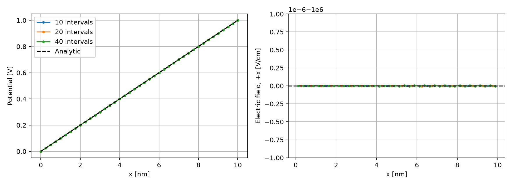
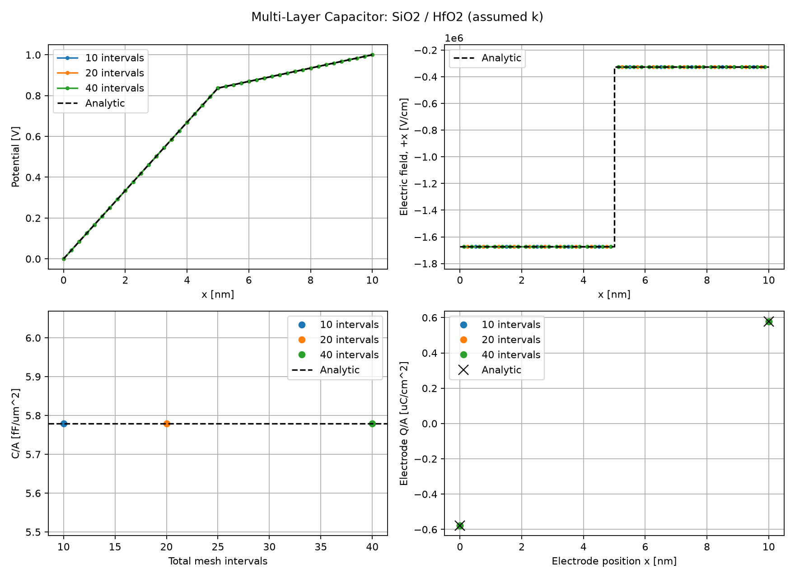
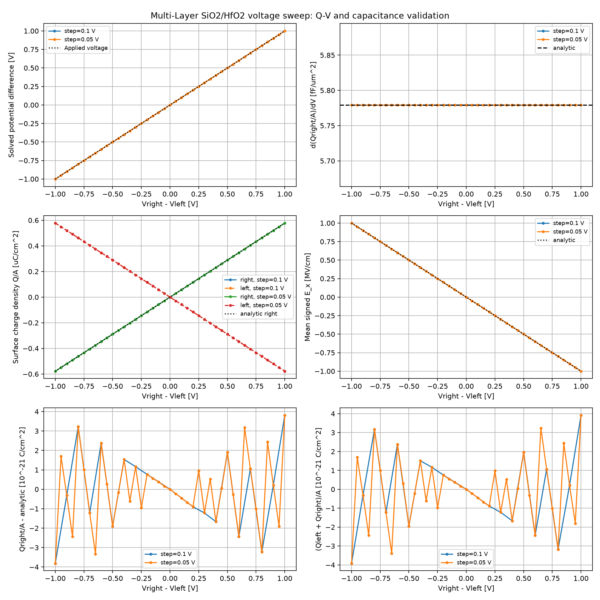
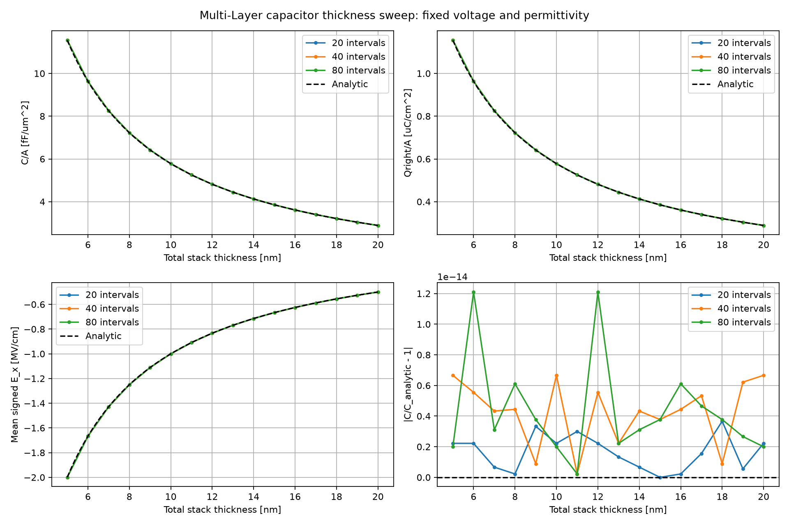

# Phase 1: 실행 가이드와 SiO2 capacitor 실험

작성일: 2026-10-03. 통합 갱신일: 2026-10-04.

## 문서 운영 원칙과 진행 상태

Phase 내 소자별 문서는 하나씩 유지한다. 앞부분에 Git·코드·테스트 진행 가이드를 두고,
뒷부분에 각 실험의 모델·실행 명령·결과·한계를 순서대로 추가한다.
이 문서에는 단층·다층 Capacitor를 통합하며, PN은 [PHASE1_PN_JUNCTION.md](PHASE1_PN_JUNCTION.md)에서 관리한다.
MOSCAP 등 후속 소자도 소자별 문서 안에 가이드와 실험 기록을 통합하고, 같은 소자의 실행 가이드와 결과 문서를 따로 만들지 않는다.
기존 PHASE1_EXECUTION.md의 가이드는 이 파일로 통합했다.

단층 SiO2 코드와 초기 테스트는 실행했다. 앞부분의 전체 Phase 1 구조와 CLI 중
아직 구현되지 않은 항목은 계획이며, 실제 단층 실행 방법은 뒷부분을 따른다.
solver_info 저장 코드는 Windows/WSL에 동기화했고, 사용자 실행 sio2_capacitor_structure/run_001에서 12개 검사 PASS를 확인했다.
2026-10-04 푸시 전 unittest 3개 메서드와 내부 subcase를 재실행해 OK를 확인했다. Phase 1 전체가 완료된 것은 아니다.
Git 게시 대상은 코드·config·문서 및 검토한 작은 기준 결과다. data/raw는 기본 제외하되
2026-10-05부터 sio2_capacitor_structure/run_001의 명시한 7개 파일만 예외로 허용한다. 임시 run.log는 제외한다.

## A. 실험 진행 가이드

### 폴더 운영 규칙: Phase → 주제 → 실행 번호

탐색기에서 같은 테스트 주제는 하나의 폴더로만 표시한다. 날짜를 결과 파일명이나
폴더명에 붙이지 않는다. 날짜·시간은 metadata에 기록한다. 재실행은 주제 내부에서
run_001, run_002처럼 번호로 구분하며 이전 결과를 덮어쓰거나 합쳐 섞지 않는다.

```text
data/raw/phase1/
  sio2_capacitor_structure/
    run_000/  # WSL에 있던 초기 구조 검증
    run_001/  # 사용자가 실행한 단층 구조·메시 검증
  sio2_capacitor_voltage_sweep/
    run_001/  # 최초 Q–V 코드 점검
    run_002/  # 그래프 표기 개선 후 최종 코드 점검
src/device/
  capacitor.py  # 구조 검증·Q–V·향후 두께 sweep에서 공용
tests/
  unit/phase1/test_capacitor_voltage.py
  regression/phase1/test_sio2_capacitor.py
```

README의 unit/regression 구분 아래 Phase를 추가한다. Q–V 추출·입력 검사는 unit에,
기존 solver 실행을 포함한 capacitor 검사 파일은 regression에 둔다. 테스트 함수와
판정 기준은 바꾸지 않았으며 이동에 필요한 config 기준 경로만 수정했다.
전체 검색은 `python -m unittest discover -s tests -p 'test*.py' -v`로 실행한다.
각 하위 폴더의 __init__.py는 재귀 테스트 검색을 위한 파일이다.

src/device에는 실험별 capacitor 사본을 만들지 않는다. 현재 구현 이름은
capacitor.py로 유지하며 조건은 configs, 실행기는 validation, 결과는 raw에서 구분한다.
이 규칙은 이후 Phase에도 적용한다. tests는 자동 검사, validation은 물리 검증 실행이라는
역할을 유지한다. 원본 metadata의 실행 경로·명령·hash는 과거 실행 증거라 수정하지 않는다.
옛 경로의 의미는 위 실행 번호와 기존 실험 기록으로 연결한다.

### A.0. 직접 진행하는 첫 실습 순서

이번 실습은 Phase 1 전체가 아니라 **단층 SiO2 검증**이다. 기존 실행 기록(B.7)은 참고값이며
자신의 실행 결과를 B.9에 별도로 기록한다. 아래 명령은 WSL bash에서 프로젝트 루트를 기준으로 실행한다.

**1단계 — 작업 위치와 입력 확인**

```bash
cd /home/iuhj0/projects/Project_Git/tcad_project
pwd
git branch --show-current
.venv/bin/python --version
cat configs/phase1/capacitor.json
```

10 nm, epsilon_r=3.9, 0→1 V인지 확인한다. 이 단계에서는 입력을 변경하지 않는다.
DEVSIM에서는 material='SiO2'라는 이름만으로 유전율이 정해지는 것이 아니라
config의 값으로 등록한 eps가 방정식에 사용된다는 점을 확인한다.

**2단계 — 계산 전에 예상값 작성**

두께를 cm로 변환하고 C/A=epsilon/t, E=-(Vright-Vleft)/t를 계산한다.
예상값은 C/A=3.453133246992e-7 F/cm², E=-1e6 V/cm이다.
왼쪽 전극 전하는 음수, 오른쪽은 양수이고 두 전하 합은 0이어야 한다.
이번 모델은 전류 I-V가 아니라 정전기 전하·전위 검증이다.

**3단계 — 구현을 함수별로 읽기**

코드는 다음 링크 또는 WSL의 같은 상대 경로에서 연다.

- [입력 config](../configs/phase1/capacitor.json)
- [소자·해석식·검사 코드](../src/device/capacitor.py)
- [실행·그래프 저장 코드](../validation/analytic/capacitor/run_capacitor.py)
- [테스트 코드](../tests/regression/phase1/test_sio2_capacitor.py)

| 읽을 순서 | 코드 | 해석하면서 답할 질문 |
|---|---|---|
| 1 | validate / assess | 음수 두께·NaN은 거부하지만 0 V solve와 Q/dV 검사는 왜 구분하는가? |
| 2 | reference | nm→cm 변환 위치와 C/A의 단위는 무엇인가? |
| 3 | simulate의 mesh/region/contact | 10 intervals일 때 왜 node는 11개인가? |
| 4 | Potential, ElectricField, Displacement 모델 | 왜 Potential@n0와 @n1 미분 모델이 필요한가? |
| 5 | equation/contact_equation | 내부 전하 없는 방정식과 양단 전위 조건은 어디에 등록되는가? |
| 6 | solve와 solver_info | Newton 업데이트 수렴과 해석식 오차 PASS는 어떻게 다른가? |
| 7 | assess | Qright/dV에서 부호를 유지하는 이유는 무엇인가? |
| 8 | runner main | 실패 상태, 기존 경로 보호, 그래프 저장은 어떻게 처리되는가? |

**4단계 — 테스트부터 실행**

```bash
.venv/bin/python -m unittest discover -s tests -p 'test_sio2_capacitor.py' -v
```

3개 테스트 메서드와 그 안의 subcase가 실행된다. 마지막 `OK`와 종료코드 0을 확인한다.
solver 테스트는 실제 DEVSIM을 호출한다. 입력 오류 검사는 기대한 ValueError를 확인하며,
결과 전하를 의도적으로 20% 변경한 검사는 검증기가 잘못된 결과를 FAIL로 판정하는지 확인한다.
여기서 실패하면 본 실행으로 넘어가지 말고 최초 traceback과 해당 subcase를 기록한다.

**5단계 — 자신의 run 생성 및 solver 로그 보존**

아래 블록은 새 출력 이름을 매번 만든다. Bash 배열로 solver의 종료코드를 tee와 구분한다.

```bash
mkdir -p data/raw/phase1
cap_run=$(mktemp -d data/raw/phase1/sio2_manual_XXXXXX)
.venv/bin/python -m validation.analytic.capacitor.run_capacitor \
  --config configs/phase1/capacitor.json \
  --output "$cap_run/results" 2>&1 | tee "$cap_run/solver.log"
cap_status=${PIPESTATUS[0]}
echo "solver exit code: $cap_status"
echo "run directory: $cap_run"
```

runner는 존재하지 않는 results 폴더를 생성한다. 로그는 그 옆에 저장하므로 경로 충돌이 없다.
위 명령에서 나온 실제 run directory를 기록하고 이후 명령도 같은 터미널에서 실행한다.
종료코드가 0이 아니면 PASS라고 기록하지 않는다. config 검증처럼 출력 생성 전 실패한 경우
metadata가 없을 수 있으므로 solver.log도 함께 확인한다.

**6단계 — 수치와 그래프 대조**

```bash
cat "$cap_run/results/validation.csv"
cat "$cap_run/results/metadata.json"
code "$cap_run/results/capacitor.png"
```

code 명령이 없으면 VS Code 탐색기에서 출력 경로를 연다. VTM은 이번 실행에서 생성하지 않는다.
10/20/40 intervals의 4개 검사, 총 12개 CSV 행을 확인한다. 모두 True이고 metadata가 PASS인지 확인한다.
mesh JSON의 solver_info에서는 각 mesh의 수렴과 반복 정보를 확인한다.
전위 그래프가 직선이고 전계는 음의 상수인지, C/A가 해석값과 일치하는지 각각 기록한다.
겹친 그래프만으로 검증을 대체하지 않는다.

**7단계 — 한 변수만 바꾸어 확인**

기준 실행을 보존한 뒤 config를 다른 이름으로 복사해 VS Code에서 한 항목만 편집한다.
새 config는 매번 --config로 지정하고 새 output을 사용한다. 아래 값은 예상 경향이지 새 실행 결과가 아니다.

| 추가 실험 | 변경 | 예상 |
|---|---|---|
| 두께 | 10→20 nm, 전압 유지 | C/A와 전계 절댓값 모두 1/2 |
| 전압 | right_V 1→0.5, 두께 유지 | C/A 일정, 전계·전하 절댓값 1/2 |
| 극성 | left_V=1, right_V=0 | C/A 양수 유지, 전계·전하 부호 반전 |
| 전위 기준 | left_V=2, right_V=3 | 전위만 +2 V, 전계·전하·C/A 유지 |

처음에는 기준 실행과 두께 변경만 진행해도 된다. 바꾼 config·결과·해석은 B.9에 이어 기록한다.
복잡한 물리 모델이나 다음 소자를 동시에 추가하지 않는다.

**8단계 — 기록 후 커밋 검토**

B.9에 입력·실제값·오차·판정·원인을 적고 B.8의 명령으로 파일을 선별한다.
이번 실습 성공은 단층 검증 완료이며 Phase 1 전체 완료가 아니다.

### A.1. 기준 작업 공간과 현재 상태

- Git 루트: `/home/iuhj0/projects/Project_Git`
- 프로젝트: `/home/iuhj0/projects/Project_Git/tcad_project`
- 개발 브랜치: `tcad`
- 최종 통합 대상: `Project_Git` 브랜치. 직접 merge 금지; `docs/GIT_WORKFLOW.md`의 경로 한정 통합을 따른다.
- Windows `TCAD_Project`는 별도 자료 사본이며 Git 저장소가 아니다. 실험·커밋 기준은 WSL이다.
- src/tests/validation에는 현재 대부분 .gitkeep만 있다. 이제 재사용 가능한 자체 코드를 작성한다.
- 자체 코드도 DEVSIM solver를 사용한다. 오픈소스 예제를 그대로 실행하는 단계에서 프로젝트의 입력·검증·재현 체계를 소유하는 단계로 바뀐다.

PowerShell에서 WSL에 들어간 뒤 실제 프로젝트를 연다.

```powershell
wsl -d Ubuntu
```

```bash
cd /home/iuhj0/projects/Project_Git/tcad_project
pwd
git rev-parse --show-toplevel
git branch --show-current
git status --short
code .
```

`code` 명령이 없다면 VS Code의 WSL 연결 기능으로 같은 Linux 경로를 연다.
터미널만 WSL로 전환한 Windows 폴더 창과 구분한다. 이후 이 문서의 bash 명령은 WSL 프로젝트 폴더 기준이다.
**하위 폴더에서 git init을 실행하거나 clone을 중복 생성하지 않는다.**

### A.2. Git 준비: 현재 변경부터 보존

확인 시 README 두 개의 수정, 분석 문서와 run.log의 미추적 상태가 있었다.
작업 내용이 바뀔 수 있으므로 항상 다시 확인한다. dirty 상태에서 pull/switch/reset하지 않는다.

1. 기존 분석 종료 문서를 검토한다. `git diff`는 미추적 파일 본문을 보여 주지 않으므로 새 문서는 직접 열어 확인한다.
2. 문서만 명시적으로 stage하고 cached diff를 검토한다. run.log와 tmp 출력은 포함하지 않는다.
3. 사용자가 검토 후 문서 종료 커밋을 만든다.

```bash
git diff -- README.md 'README_TCAD_MOSFET_PROJECT_Github 주소 반영본.md'
git add -- docs/opensource_analysis.md docs/PHASE1_SIO2_CAPACITOR.md
git add -- README.md 'README_TCAD_MOSFET_PROJECT_Github 주소 반영본.md'
git diff --cached --check
git diff --cached --stat
git diff --cached
git commit -m "docs(tcad): conclude example analysis and plan phase 1"
```

commit은 위 검토가 끝난 뒤 실행한다. 다른 작업의 staged 변경이 있으면 먼저 소유자와 구분한다.
run.log는 삭제하지 않고 보존하되 stage하지 않는다. 새 실행 로그는 Git 제외인 data/raw 아래에 저장한다.
원격 확인/동기화는 작업 내용을 보존한 뒤 `git fetch origin`, `git status -sb`로 시작한다.
behind 상태이고 충돌할 로컬 변경이 없을 때만 `git pull --ff-only origin tcad`를 사용한다.
이번 단계는 tcad에서 계속 개발하며 불필요한 분기·force push·Project_Git 직접 병합을 하지 않는다.

### A.3. 첫 코드 작성 전 모델 명세

docs/methodology.md에 다음을 작성하고 config와 일치시킨다.

| 항목 | Phase 1에서 고정·검사할 내용 |
|---|---|
| 단위 | 내부 cm, V, cm^-3, F/cm 등; nm→cm 변환은 한 곳에서 수행 |
| 전류·전하 | API 출력의 차원/단면적/폭 의미; 1D 면적과 2D 폭 정규화를 분리 |
| 온도·물성 | 온도, epsilon, ni 등의 값·출처·버전 |
| 방정식 | 유전체 Poisson, 반도체 Poisson/DD, 통계·재결합 선택 |
| 경계조건 | 접촉 bias, work function 기준, 계면전하 유무, 전위 연속성 |
| 수치 조건 | mesh, 영역 크기, bias step, 절대·상대 허용오차, 최대 반복 |
| 검증 조건 | 해석식이 유효한 조건, 공핍 경계 판정법, 비교 오차 정의 |

처음부터 고농도·고전계의 복잡한 모델을 추가하지 않는다. 해석식과 비교 가능한 단순 조건에서
Poisson/접촉/계면의 정확도를 먼저 확인하고 PN의 DD로 확장한다.
모델 계수를 결과에 맞춰 임의 조절하지 않는다. 예제 코드 재사용 시 출처·라이선스·변경 내용을 남긴다.

### A.4. 구현할 코드 구조와 책임

아래는 **전체 Phase 1 제안 구조**다. 한 번에 모두 만들지 않고 capacitor부터 수직으로 완성한다.
현재 단층 구현 파일명과 실제 명령은 B절을 우선한다.

| 제안 파일 | 역할 | 먼저 작성할 테스트 |
|---|---|---|
| configs/phase1/*.json | 구조·물성·bias·mesh·허용오차 | 필수값, 양의 두께/유전율, 단위 검증 |
| src/utils/units.py | 단위 변환·정규화 | nm→cm, 잘못된 값 거부 |
| src/utils/run_io.py | run ID·입력 복사·metadata·CSV | 출력 충돌 거부, UTF-8, 실패 상태 보존 |
| src/device/capacitor.py | 단층/다층 1D mesh·영역·계면 | 영역 수·길이·접촉·계면 |
| src/physics/electrostatics.py | 유전율·전위 모델·경계식 | 경계 전위·전속 부호 |
| src/solver/dc.py | solve wrapper와 실패 전달 | 예외를 성공/0으로 바꾸지 않음 |
| validation/analytic/reference.py | 독립적인 해석식 | 단층 극한, 같은 유전율의 다층 극한 |
| validation/analytic/capacitor/run_capacitor.py | 단층/다층 실행·비교·판정 | 해석값 대비 오차 |
| src/device/pn.py, run_pn.py | PN 구조 및 평형/DD 검증 | Vbi·공핍 폭·전류 보존 |
| src/device/moscap.py, run_moscap.py | MOSCAP 구조 및 Q-V/C-V | Cox·Vfb·표면전위·전하 보존 |
| tests/ | solver 없는 단위 테스트와 solver 통합 테스트 분리 | 수집된 테스트 수와 실패 메시지 |

표의 run_pn.py/run_moscap.py는 validation/analytic/ 아래에 둔다.
모듈 실행을 위해 필요한 __init__.py와 테스트 설정을 추가한다. DEVSIM 전역 상태가
테스트 간 누적되지 않도록 장치 정리 fixture 또는 독립 프로세스 실행을 설계한다.
solver 계산값을 그대로 정답으로 쓰지 않고 해석식 구현과 수치 모델 구현을 분리한다.

### A.5. 실험 구현·실행 순서

#### A.5.1 단층 capacitor

입력: 두께, 유전율, 양단 전압, mesh 간격.
출력: 위치별 Potential/E/D, 접촉 전하, C/A.
비교: C/A=epsilon/t, 선형 전위, 일정 전계. 접촉 전하 부호 규약을 먼저 확인한다.
전압차 0으로 Q/V를 나누지 않고 유한 전압차 또는 전하 미분으로 C를 구한다.
자동 판정: 정전용량 오차 <1%; 경계전위·전속·전하 균형 허용오차도 별도로 명시.

#### A.5.2 다층 capacitor

비교: (C/A)^-1=sum(t_i/epsilon_i), 각 층 전압 강하, 자유 계면전하가 없을 때 D 연속성.
동일 유전율 극한, 층 두께 변경, 유전율 변경→복원 테스트를 포함한다.
정전용량 오차 <1%. 변경 후 반드시 다시 solve한 결과끼리 비교한다.

#### A.5.3 PN 접합

비축퇴 급격 접합의 평형 조건부터 구현한다. Vbi와 공핍 근사 적용 조건을 config/보고서에 명시한다.
Vbi 오차 <2%, 공핍 폭 오차 <5%를 초기 기준으로 사용한다.
도핑 불연속의 위치와 공핍 경계 추출법을 고정하고, 근사 자체의 오차와 mesh 오차를 분리한다.
이후 작은 bias부터 DD sweep을 구현하고 전자+정공을 합한 모든 단자 전류 보존을 검사한다.
Shockley 식과의 정확한 일치를 모든 조건의 통과 기준으로 강제하지 않는다.

#### A.5.4 MOSCAP

단순 gate/oxide/semiconductor에서 시작하고 고정 계면전하 유무와 work-function 기준을 명시한다.
Gate sweep의 Qg·표면전위·carrier 분포를 저장한다. 준정적 C=dQg/dVg를 계산하고
정규화한 Cox 오차 <3%, Vfb와 work-function 부호, 축적·공핍·반전의 일관성을 검사한다.
Vfb/표면전위의 수치 허용오차는 기준해·정의와 함께 실행 전에 정한다.
미분의 bias 간격과 경계점 차분법을 기록한다. 준정적 C-V를 고주파 C-V로 이름 붙이지 않는다.

#### A.5.5 Mesh·step 민감도

각 소자의 coarse/medium/fine에서 C, Vbi, 공핍 폭, 표면전위 등을 비교한다.
Gate/bias step을 절반으로 줄여 특히 Q 미분의 안정성을 확인한다.
Phase 2용 Ion/Vth/SS 수렴 기준을 Phase 1 소자에 무리하게 적용하지 않는다.
fine도 절대 정답이 아니다. 기준 미달이면 허용오차를 사후 완화하기 전에 단위·경계·영역·mesh를 점검한다.

### A.6. 테스트 명령과 출력 계약

현재 바로 실행 가능한 것은 환경·경로 확인이다. 아래 CLI는 **위 코드와 의존성을 구현한 뒤** 사용할 제안이다.
pytest 등 필요한 도구는 개발 의존성 파일에 선언하고 실제 설치 버전을 기록한다.

```bash
.venv/bin/python -m pytest tests/unit -q
.venv/bin/python -m pytest tests/regression -q
.venv/bin/python -m validation.analytic.capacitor.run_capacitor --config configs/phase1/capacitor.json
.venv/bin/python -m validation.analytic.run_pn --config configs/phase1/pn.json
.venv/bin/python -m validation.analytic.run_moscap --config configs/phase1/moscap.json
```

CLI는 실패하면 nonzero exit code를 반환하도록 구현한다. `no tests ran` 또는 import만 성공한 상태를
물리 검증 PASS로 기록하지 않는다. 예제의 큰 absolute_error를 의미 검토 없이 복사하지 않는다.

각 실행은 data/raw/phase1/<run_id>/에 다음을 남긴다.

- config.json: 기본값까지 펼친 실제 입력 및 단위.
- metadata.json: UTC 시간, Git commit/dirty 상태, Python/DEVSIM/의존성 버전, 실행 명령, 입력 해시.
- solver.log 및 convergence.csv: bias, 수렴 여부, 반복·오차 정보, 실패 이유.
- profiles.csv 및 terminal.csv: 단위가 명시된 원시 필드·단자값.
- validation.csv: 검사명, 예상값, 계산값, 절대/상대오차, 허용오차, PASS/FAIL.

수치 실패·추출 불가 값은 NaN과 상태로 남기고 0으로 채우지 않는다. 0 근처 보존 검사는
|sum I| <= atol + rtol*sum|I| 형태로 수행하며 atol은 단위와 측정한 수치 잡음 바닥에 맞춰 사전 고정한다.
정전용량·전위·전류에 같은 atol을 재사용하지 않는다. 정식 비교표/대표 그래프는
data/processed/phase1/와 figures/phase1/에 선별해 저장하고 run ID로 원시 결과와 연결한다.

### A.7. Git 커밋 단위와 검증 주기

| 순서 | 커밋 범위 예시 | 커밋 전 검사 |
|---|---|---|
| 1 | docs: 모델 명세·출력 계약 | 단위·출처·가정 검토 |
| 2 | feat: 단위/config/run IO + test | solver 없는 단위 테스트 |
| 3 | feat/test: 단층·다층 capacitor | 물리 검사, mesh 비교 |
| 4 | feat/test: PN | Vbi·공핍 폭·보존 검사 |
| 5 | feat/test: MOSCAP | Cox·표면전위·step 검사 |
| 6 | docs/test: Phase 1 요약·회귀 기준 | 전체 재실행 및 추적성 |

코드·테스트·관련 config를 같은 커밋에 포함한다. 아래 add 경로는 실제 구현된 파일에 맞게 좁힌다.

```bash
git status --short
git diff --check
git diff -- src tests validation configs docs
git add -- src/utils/units.py tests/unit/test_units.py
git diff --cached --check
git diff --cached
git commit -m "feat(tcad): add tested unit conversions"
```

생성물을 무조건 `git add .` 하지 않는다. 작은 기준 CSV와 대표 그림은 검토 후 선택적으로 추적한다.
raw/venv/tmp/PDF 제외 규칙을 확인한다. ignored raw는 경로·해시만으로 복구되지 않으므로
재현 명령 또는 별도 보관 위치도 남긴다. API 토큰·개인 경로 등 불필요한 정보는 배포 로그에서 제외한다.
검토된 커밋은 `git push origin tcad`로 게시한다. 이는 사용자가 실행할 후속 단계이며 이번 작업에서 실행하지 않았다.

### A.8. Phase 1 종료와 다음 단계

- [ ] 모델·단위·경계조건 문서와 실제 config 일치
- [ ] capacitor·PN·MOSCAP 자동 판정과 실패 테스트 구현
- [ ] 필수 bias 수렴 및 원시 출력의 NaN/Inf 검사
- [ ] mesh·bias-step 민감도와 해석식 적용 한계 기록
- [ ] clean 환경에서 재현 가능한 명령·의존성 제공
- [ ] 검증 요약과 run ID·코드 버전 연결, 검토된 commit 완료

전부 충족한 뒤 Phase 2의 1 um long-channel NMOS 및 공통 특성 추출로 진행한다.
Phase 1 자체에는 성능 최적화 개선율을 요구하지 않는다. 먼저 수치 결과를 신뢰할 기반을 만든다.

## B. 단층 SiO2 capacitor 실험

### B.1. 범위와 구현 파일

2026-10-04 첫 자체 검증 코드. 이상적인 평판 전극 사이의 **전하가 없는 단층 유전체**를 1D로 푼다.
MOSCAP이 아니며 Si bulk·도핑·carrier·이동도·누설·터널링을 포함하지 않는다.
단층 검증 이후 다층 유전체, PN, MOSCAP 순으로 확장한다.

| 파일 | 역할 |
|---|---|
| configs/phase1/capacitor.json | 두께·유전율·전압·mesh·검증 허용오차 |
| src/device/capacitor.py | 입력 검사, 독립 해석식, DEVSIM 구조/방정식, 결과 판정 |
| validation/analytic/capacitor/run_capacitor.py | 3단계 mesh 실행, JSON/CSV/PNG 저장, 실행 metadata |
| tests/regression/phase1/test_sio2_capacitor.py | 입력 오류·해석값·전압 반전·offset·두께 변화·판정 실패 테스트 |

첫 단층 예제를 따라가기 쉽게 모델 코드는 한 모듈에 모았다. 다층 확장 시 공통 물리/solver/IO를 분리한다.
API 연결 방식은 설치된 DEVSIM 2.11의 testing/cap2.py를 참고했으며 원본 예제 전체 복사 실행과 구분한다.
추가 패키지 설치 없이 기존 requirements.in의 DEVSIM·matplotlib와 표준 unittest를 사용한다.

### B.2. 모델과 기대값

- x=0: 0 V, x=t: 1 V의 Dirichlet 경계조건.
- t=10 nm=1e-6 cm, epsilon_r=3.9, epsilon_0=8.8541878128e-14 F/cm.
- epsilon_r는 이번 이상적 SiO2 검증의 고정 가정이며 측정 데이터에 맞춘 보정값이 아니다.
- 전위 방정식: d/dx(epsilon*d(phi)/dx)=0. 내부 전하와 내부 계면은 없다.
- phi(x)=Vleft+(Vright-Vleft)*x/t.
- E=-d(phi)/dx=-1e6 V/cm, D=epsilon*E=-3.453133246992e-7 C/cm².
- C/A=epsilon/t=3.453133246992e-7 F/cm² = 약 3.45313 fF/um².
- 오른쪽 전극 Q/A=+3.453133246992e-7 C/cm², 왼쪽은 반대 부호.

이 1D 평면 모델의 API 접촉 전하는 단위 단면적에 대응하므로 C/cm²로 해석한다.
실제 총 C[F]는 (C/A)*A[cm²]이다. 이 규약을 기존 2D MOSFET 전류 정규화에 그대로 적용하지 않는다.
코드는 오른쪽의 부호 있는 접촉 전하를 전압차로 나누어 C/A를 구한다. abs로 부호 오류를 숨기지 않는다.
edge 전계는 n0→n1 방향이다. endpoint 좌표로 +x 방향을 확인한 뒤 해석 전계와 비교한다.

### B.3. 실행 위치와 Git 확인

VS Code도 WSL 프로젝트를 열어야 한다. Windows 자료 사본에서 Python을 실행하지 않는다.

```bash
cd /home/iuhj0/projects/Project_Git/tcad_project
git rev-parse --show-toplevel
git branch --show-current
git status --short
```

Git 루트는 상위 Project_Git, 개발 브랜치는 tcad다. 새 git init은 하지 않는다.
기존 문서 변경과 run.log는 보존하고 이번 파일과 구분한다.

### B.4. 테스트 → 실제 검증 실행

```bash
.venv/bin/python -m unittest discover -s tests -p 'test_sio2_capacitor.py' -v
.venv/bin/python -m validation.analytic.capacitor.run_capacitor --config configs/phase1/capacitor.json --output data/raw/phase1/sio2_capacitor_structure/run_001
```

첫 명령은 3개 테스트 메서드를 실행하며 여러 입력/solver subcase를 포함한다.
두 번째는 10/20/40 intervals를 계산한다. 기존 output 경로가 있으면 덮어쓰지 않고 중단한다.
재실행은 sio2_capacitor_structure/run_002처럼 새로운 이름을 사용한다. zero-voltage Q/dV는 지원하지 않고 명시적으로 거부한다.
실패 판정은 종료코드 1, 예외 발생은 ERROR 기록 후 nonzero 종료다. 실패값을 0으로 채우지 않는다.

### B.5. 출력과 판정

| 출력 | 확인 항목 |
|---|---|
| config.json | 실제 입력과 사전 설정 허용오차 |
| metadata.json | PASS/FAIL/ERROR, 버전, Git commit/dirty, 소스·config 해시 |
| mesh_10/20/40.json | node 좌표/전위, edge 전계/전속, 양단 전하, solver_info |
| validation.csv | 실제 node 수, C/A, 각 오차·허용오차·판정 |
| capacitor.png | 3개 mesh의 전위/전계 및 해석선 |
| error.txt | 실행 도중 예외가 난 경우 traceback |

허용오차는 C/A 상대오차 <1%, 전위 최대오차 <1e-9 V, 전계 상대오차 <1e-8,
양단 전하 합의 절댓값 <1e-14 C/cm²다. 이들은 이번 선형 문제의 설정이지 모든 소자의 보편적 기준이 아니다.
solve 업데이트 기준은 absolute_error=1e-12, relative_error=1e-10, 최대 30회다.
solver_info의 수렴 여부를 별도로 검사하며 업데이트 기준과 해석식 오차 기준을 구분한다.
metadata의 dirty 상태에서는 commit hash만으로 재현할 수 없으므로 실제 소스와 config도 함께 보관해야 한다.

### B.6. 그래프 읽기

VS Code에서 output의 capacitor.png를 연다. Agg 모드이므로 팝업 창이 뜨지 않는 것이 정상이다.
왼쪽 전위는 0→1 V 직선이며, 오른쪽 +x 전계는 -1e6 V/cm의 일정한 값이어야 한다.
세 mesh와 해석선이 겹치는 것이 예상 결과다. 이 문제는 선형 해가 이산화로 정확히 표현되므로
mesh를 줄일 때 오차가 단조 감소하지 않고 반올림 수준에서 흔들릴 수 있다.
그래프만 보고 PASS를 판단하지 않고 validation.csv도 확인한다.
이번 구현은 PNG/JSON/CSV 출력이며 ParaView VTM을 생성하지 않는다.

### B.7. 최초 검증 기록과 한계

초기 실행 data/raw/phase1/sio2_capacitor_structure/run_000에서 11/21/41 node 모두 4개 검사 PASS였다.
C/A 상대오차 최대 약 2.0e-15, 전위 오차 최대 약 1.11e-16 V,
전계 상대오차 최대 약 2.56e-15, 전하 합 최대 약 6.88e-22 C/cm²였다.
최초 실행 이후 solver_info 저장을 추가했고 Windows/WSL 코드를 동기화했다.
사용자 실행 sio2_capacitor_structure/run_001(2026-10-04 16:55 KST)의 metadata는 PASS이며 3개 mesh의 12개 검사가 모두 True다.
해당 실행의 오차는 위 초기 실행과 같은 값이며 mesh JSON에 solver_info가 저장된 것을 확인했다.
2026-10-04 게시 전 unittest도 3개 테스트 메서드와 내부 subcase 모두 OK였다.
현재 결과는 단층 정전기 구현의 검증이며 Phase 1 전체 완료, SiO2 누설/신뢰성 또는 실제 공정 정확도를 뜻하지 않는다.

### B.8. 검토 후 Git 커밋

아래는 후속 변경을 검토한 후 사용하는 커밋 절차다. 이미 게시된 파일은 변경이 있을 때만 stage한다.

```bash
git diff --check
git add -- configs/phase1/capacitor.json src/device/capacitor.py
git add -- validation/analytic/capacitor/run_capacitor.py tests/regression/phase1/test_sio2_capacitor.py
git add -- docs/PHASE1_SIO2_CAPACITOR.md
git diff --cached --stat
git diff --cached
git commit -m "feat(tcad): validate single-layer SiO2 capacitor"
```

다른 staged 변경이 있으면 함께 커밋하지 않도록 먼저 구분한다. data/raw는 Git 제외다.
코드/config/manual은 추적하고, 대표 결과는 검토 후 data/processed 또는 figures에 선별 보관한다.
이후 tcad로 push하는 절차는 이 문서 A.7절을 따른다. Project_Git 직접 merge는 하지 않는다.
다음 구현은 단층 두께/유전율 scaling 검사를 확장하고, 다층 계면 전위·전속 연속성을 검증하는 것이다.

Windows VS Code에서도 `data/raw/phase1/sio2_capacitor_structure/run_001/`을 열 수 있도록 WSL 실행 폴더를 복사했다.
원본은 WSL이며 Windows 쪽은 확인용 스냅샷이다. 자동 동기화가 아니므로 후속 실행 결과는 별도로 복사해야 한다.
탐색기에서 data → raw → phase1 → sio2_capacitor_structure/run_001을 펼쳐 PNG/CSV/JSON을 연다.
원시 결과는 기본 Git 제외 정책을 유지한다. B.10에서 지정한 기준 실행의 7개 파일만 예외로 공개할 수 있다.

### B.9. 사용자 직접 실행 기록 양식

아래 양식을 실행별로 이 문서 안에 복사한다. 기존 B.7의 결과를 자신의 실제값 칸에 옮겨 적지 않는다.

#### 실험: [기준/두께 변경/전압 변경]

- 실행 일시와 run directory: 미기록
- 코드 commit/dirty 및 source hash: 미기록
- config 경로와 변경한 항목: 미기록
- 목적과 사전 예상: 미기록
- 테스트 결과 및 실행 종료코드: 미실행
- solver 수렴·반복 정보: 미기록

| 항목 | 해석값/기준 | 실제값 | 오차 | 판정 |
|---|---|---|---|---|
| C/A [F/cm²] | epsilon/t | 미측정 | 미측정 | 미판정 |
| E [+x, V/cm] | -dV/t | 미측정 | 미측정 | 미판정 |
| Potential 최대오차 [V] | <1e-9 | 미측정 | 해당 값 | 미판정 |
| Qleft+Qright [C/cm²] | 절댓값 <1e-14 | 미측정 | 해당 값 | 미판정 |
| 10/20/40 mesh 검사 | 각 4개 검사 PASS | 미실행 | CSV 참조 | 미판정 |

- 전위·전계 그래프 해석: 미기록
- 이전 실험과 달라진 점 및 물리적 이유: 미기록
- 실패/예상과 다른 값의 원인 점검: 미기록
- 결론과 다음 행동: 미기록

실패 시 단위 변환 → 양단 bias → epsilon → 접촉 전하 부호 → solver_info 순서로 확인한다.
오차가 기준보다 크다고 허용오차부터 늘리지 않는다. 실패 실행도 삭제하지 말고 수정 후 새 run으로 비교한다.

### B.10. 단층 기준 실행의 결과 분석 (2026-10-05 기록)

#### 1. 질문

자체 구현한 전하 없는 단층 SiO2 모델이 선형 전위, 일정한 전계, C/A=epsilon/t 및
양단 전하 보존을 만족하는가? 10/20/40 구간에서 그 결론이 유지되는가?
Voltage sweep과 두께 sweep은 이번 실행에서 수행하지 않았다. 단위 테스트의 일부 조건 변경을
독립적인 sweep 데이터셋이나 sweep 분석 완료로 계산하지 않는다.

#### 2. 예상

t=10 nm=1e-6 cm, epsilon=3.9*8.8541878128e-14=3.453133246992e-13 F/cm이다.
내부 자유전하가 없고 epsilon이 일정하므로 d²phi/dx²=0이며 phi(x)=x/t V다.
E=-dphi/dx=-1e6 V/cm, D=epsilon*E=-3.453133246992e-7 C/cm²이다.
오른쪽 전극 Q/A는 +3.453133246992e-7 C/cm², 왼쪽은 반대 부호다.
C/A=(Qright/A)/1 V=3.453133246992e-7 F/cm²=3.453133246992 fF/um²이다.

#### 3. 조건과 근거

- 실행: `data/raw/phase1/sio2_capacitor_structure/run_001`, 2026-10-04 16:55 KST.
- 고정 조건: 10 nm, 상대유전율 3.9, left=0 V/right=1 V, 전하 없는 선형 유전체.
- 변경 조건: mesh 10/20/40 intervals만 변경; 실제 node는 11/21/41개.
- 환경: Python 3.14.4, DEVSIM 2.11.0, matplotlib 3.11.2.
- 근거: 아래 CSV, 실행 당시 config/metadata, mesh JSON, Python 생성 PNG.
- 실행 당시 Git 상태는 dirty이며 commit은 bf3c7ee였다. 현재 게시 커밋에서 실행했다고 metadata를 바꾸지 않는다.
- 1D 분석은 Python 정량 그래프 중심으로 진행하며 ParaView는 사용하지 않는다.

#### 4. 결과: 그래프와 수치



[검사 CSV](../data/raw/phase1/sio2_capacitor_structure/run_001/validation.csv),
[입력](../data/raw/phase1/sio2_capacitor_structure/run_001/config.json),
[실행 metadata](../data/raw/phase1/sio2_capacitor_structure/run_001/metadata.json).

| intervals / nodes | C/A [F/cm²] | C/A 상대오차 | 최대 전위오차 [V] | 최대 전계 상대오차 | 전하 합 절댓값 [C/cm²] |
|---|---:|---:|---:|---:|---:|
| 10 / 11 | 3.453133246991999e-7 | 3.33e-16 | 2.78e-17 | 9.31e-16 | 5.29e-23 |
| 20 / 21 | 3.453133246992000e-7 | 0 | 1.11e-16 | 1.98e-15 | 5.29e-23 |
| 40 / 41 | 3.453133246992007e-7 | 2.00e-15 | 1.11e-16 | 2.56e-15 | 6.88e-22 |

상대오차는 무차원 비율이며 백분율이 아니다. 각 mesh의 네 검사, 총 12개 행이 True이고 metadata는 PASS다.
허용오차는 C/A 0.01, 전위 1e-9 V, 전계 1e-8, 전하 합 1e-14 C/cm²이다.

#### 5. 해석

왼쪽은 x=0에서 0 V, x=5 nm에서 약 0.5 V, x=10 nm에서 1 V인 직선이다.
세 mesh와 검은 해석선이 겹치는 것은 누락된 곡선이 아니라 수치해가 같은 선형 해와 일치하기 때문이다.

오른쪽 전계가 눈금 0에 놓여 보여도 **전계 0을 뜻하지 않는다**.
상단의 `1e-6`은 눈금의 배율, `−1e6`은 더하는 offset이다.
즉 실제 E = 표시 눈금*1e-6 − 1e6 V/cm이며 표시 눈금 0은 E=−1e6 V/cm이다.
전계는 전위 증가 방향과 반대인 −x 방향이고 내부에서 거의 일정하다.
그래프가 극히 좁은 범위로 자동 확대되어 있으며 CSV상 최대 절대 전계 오차는
약 2.56e-15*1e6=2.56e-9 V/cm에 불과하다.

같은 epsilon에서 D도 일정하고 양단 전하는 상쇄된다. 측정된 전하 잔여값은 허용오차보다 충분히 작다.
선형 해를 이산 모델이 거의 정확히 표현하므로 mesh 증가에 따라 오차가 단조 감소하지 않고
부동소수점 반올림 수준에서 변한다. 20구간의 표시 오차 0은 모든 상황에서 오차가 없음을 보장하지 않는다.
40구간의 작은 상대오차 증가를 수치적 발산 또는 물리 모델 악화로 해석하지 않는다.

#### 6. 판정·한계·다음 단계

이번 조건에서 단층 정전기 경계조건·전위·전계·정전용량·전하 보존 검증은 PASS다.
실제 재료 측정값에 대한 calibration, 누설/터널링/절연 파괴/신뢰성, MOS 반전 및 NMOS 성능은 검증하지 않았다.
Phase 1 전체 완료 또는 B28 대비 성능 개선으로 보고하지 않는다.

이 기준 실행을 분석한 당시에는 단층 실행 완료 → 공간 분포/CSV 오차 분석 완료 → Voltage sweep 미실시 → 두께 sweep 미실시였다.
이후 Q–V 구현과 코드 점검 실행은 C절에 별도로 기록하며 사용자 직접 실행과 구분한다.
후속 Python 그래프는 절대 E를 MV/cm로 표시하고, phi 및 E의 수치해−해석해를 별도 패널로
그리는 방식을 우선한다. 오차의 단위와 배율을 명시하고 그림을 매끄럽게 만들기 위한 데이터 조작은 하지 않는다.
이는 다음 구현 방향이며 이번 기록에서 원본 PNG나 simulation 결과를 다시 생성하지 않았다.

#### Git 결과 공개 범위와 기준 문서

`.gitignore`에서 `data/raw/phase1/sio2_capacitor_structure/run_001/`의 validation.csv, capacitor.png,
config.json, metadata.json, mesh_10.json, mesh_20.json, mesh_40.json만 예외로 허용한다.
다른 raw 실행과 임시 로그는 계속 제외한다. metadata의 로컬 경로·당시 dirty 상태는 재현 근거로 보존한다.
ignore 예외 설정만으로 GitHub에 자동 업로드되지는 않으며 검토 후 add/commit/push가 필요하다.

사용자가 지정한 README_TCAD_MOSFET_PROJECT_Github_구조정리본.md를 실행·폴더 구성의 기준,
TCAD_PROJECT_FINAL_GOAL.md를 최종 목표·KPI 기준으로 읽고 적용한다.
src는 공통 구현, validation은 물리 검증, experiments는 실험별 실행/조건으로 구분한다.
후속 gate-stack 실험은 03_gate_stack 아래에 통합하고 doping/spacer/optimization은 최신 Phase–폴더 대응을 따른다.
기존 WSL 폴더와 새 대응표의 차이는 이동 전 경로·참조를 점검하여 정리하며 이번에는 임의 재배치하지 않는다.
개발은 기존 tcad 브랜치와 실제 tcad_project 경로를 유지한다. 다른 프로젝트를 보존하기 위해
Project_Git 통합은 기존 GIT_WORKFLOW의 경로 한정 절차를 따르고 force push·직접 병합하지 않는다.
최종 목표는 자체 B28 기준, 동일 모델·추출·bias·폭 조건에서 2–3변수 DOE와 feasible Pareto 후보를
평가하고 fine mesh/작은 step에서 재검증한 개선율과 trade-off를 보고하는 것이다.
EOT는 층별 두께/유전율에서 계산하는 파생값이다. 목표 문서의 예시 개선율은 실적이나 강제 목표로 사용하지 않는다.

## C. 다음 실습: 단층 SiO2 Voltage sweep

### C.1. 질문·예상·조건

질문: bias를 음수→0→양수로 바꿀 때 양단 전하는 선형적으로 변하며,
Q–V 기울기에서 구한 정전용량이 epsilon/t와 일치하는가? 전압 간격을 절반으로 줄여도 같은가?

고정: t=10 nm, epsilon_r=3.9, left_V=0 V, 40 intervals(41 nodes), 이전과 같은 정전기 모델.
변경: delta V=Vright−Vleft=-1~1 V; 0.1 V 간격 21점과 0.05 V 간격 41점.
정적 DC 해석 총 62회이며, 각 bias는 독립 소자를 생성하고 해석 후 정리한다.
이 선형 실험은 이전 해를 이용하는 rampbias 방식이나 시간 의존 충방전 해석이 아니다.

예상: Qright/A=(epsilon/t)*delta V, Qleft=-Qright.
기울기 C/A=3.453133246992e-7 F/cm²=3.453133246992 fF/um², 절편 0.
0 V에서는 양단 전하와 전계가 0이지만 정전용량은 0이 아니다.
이상적 유전체의 정전용량은 전압에 무관하다. 실제 MOSCAP의 축적·공핍·반전 C–V와 구분한다.

### C.2. 코드와 읽을 순서

| 파일 | 변경·역할 |
|---|---|
| configs/phase1/capacitor_voltage.json | 기존 모델을 model에 포함하고 bias 범위·점 수·추출 허용오차 정의 |
| src/device/capacitor.py | 0 V solve 허용; 기존 assess의 Q/dV만 0 V에서 거부 |
| src/extraction/capacitance.py | Qright/A의 선형 회귀 기울기와 국소 수치 미분 |
| validation/analytic/capacitor/run_voltage.py | bias별 해석·검사·저장, 두 step 비교, Python 그래프 |
| tests/unit/phase1/test_capacitor_voltage.py | 알려진 기울기/절편, 미분의 끝점, 잘못된 데이터/config 검사 |
| tests/regression/phase1/test_sio2_capacitor.py | 기존 검증 + 양단 0 V/동일 2 V에서 전하·전위 검사 |

0 V에서 Q/V를 계산하지 않는다. 회귀는 전체 Q–V 점의 기울기를 사용하고,
국소 정전용량은 numpy.gradient(edge_order=2)로 내부 중앙차분·끝점 2차 단측차분을 사용한다.
실패점이 있으면 해당 실행은 ERROR로 중단하고 앞서 완료된 행·state를 보존한다.
실패점을 0으로 채워 기울기를 계산하지 않는다. NaN/Inf, 중복/역순 voltage 배열도 거부한다.
src는 공통 구현/추출이며 이 실험 실행기는 기준 문서에 맞춰 validation/analytic/capacitor에 둔다.

### C.3. 그대로 실행하기

아래는 WSL bash 기준이다. 이전 단층 결과 폴더를 재사용하지 않는다.

```bash
cd /home/iuhj0/projects/Project_Git/tcad_project
.venv/bin/python -m unittest discover -s tests -p 'test*capacitor*.py' -v
```

8개 테스트 메서드와 내부 subcase가 실행되며 마지막 OK를 확인한다. 실패하면 다음 단계로 진행하지 않는다.

```bash
mkdir -p data/raw/phase1/sio2_capacitor_voltage_sweep
run_index=1
while :; do
  printf -v voltage_run 'data/raw/phase1/sio2_capacitor_voltage_sweep/run_%03d' "$run_index"
  if [ ! -e "$voltage_run" ]; then mkdir "$voltage_run" || break; break; fi
  run_index=$((run_index + 1))
done
.venv/bin/python -m validation.analytic.capacitor.run_voltage \
  --config configs/phase1/capacitor_voltage.json \
  --output "$voltage_run/results" 2>&1 | tee "$voltage_run/solver.log"
qv_status=${PIPESTATUS[0]}
echo "exit code: $qv_status"
echo "run directory: $voltage_run"
```

마지막 출력에서 PASS와 종료코드 0을 확인한다. 로그가 길어도 프로그램이 멈춘 것은 아니다.
각 bias에서 41개 방정식을 푸는 정보가 출력된다. 결과를 여는 명령:

```bash
cat "$voltage_run/results/summary.json"
cat "$voltage_run/results/metadata.json"
explorer.exe "$(wslpath -w "$voltage_run/results")"
```

Windows VS Code의 현재 자료 사본에서도 보려면 같은 WSL 터미널에서 다음을 실행한다.
새 이름인지 확인하고 기존 결과를 덮어쓰지 않는다.

```bash
win_phase1='/mnt/c/Users/iuhj0/OneDrive/바탕 화면/TCAD_Project/data/raw/phase1/sio2_capacitor_voltage_sweep'
mkdir -p "$win_phase1"
win_voltage_target="$win_phase1/$(basename "$voltage_run")"
if [ -e "$win_voltage_target" ]; then
  echo "Destination exists; no copy performed."
else
  cp -a "$voltage_run" "$win_voltage_target"
fi
```

이는 확인용 복사이고 자동 동기화는 아니다. 새 터미널에서는 voltage_run을 실제 출력 경로로 다시 지정한다.

### C.4. 출력과 그래프 분석 순서

| 출력 | 읽을 내용 |
|---|---|
| qv.csv | 두 sweep의 62개 bias·전하·오차·수렴 및 반복 기록 |
| validation.csv | bias별 5개 검사, sweep별 회귀/국소C/절편 검사, step 비교 총 318개 |
| summary.json | 해석 C/A, 두 step의 회귀 C/A, 총 검사/실패 수 |
| qv.png | 아래 네 패널 |
| points_21/, points_41/ | bias별 state JSON 및 extraction.json |
| config.json, metadata.json | 실제 입력·코드 hash·버전·dirty 상태·PASS/FAIL/ERROR |

1. 왼쪽 위: 양단 Q/A가 원점을 지나는 반대 기울기의 직선인지 확인한다. 단위는 uC/cm².
2. 오른쪽 위: 국소 d(Qright/A)/dV가 약 3.45313 fF/um²로 일정하고 0 V에서도 정의되는지 확인한다.
3. 왼쪽 아래: 수치 Qright/A−해석값을 본다. 단위는 명시적인 10^-21 C/cm²이며 offset을 사용하지 않는다.
4. 오른쪽 아래: 양단 전하 합을 본다. 같은 오차 단위이며 0에 가까워야 한다.

아래 패널은 매우 작은 오차를 확대한 그림이다. 꺾이는 선을 물리적 진동이나 누설이라고 해석하지 않는다.
CSV의 C 단위 오차 및 허용오차와 같이 읽는다. 원시 데이터/그림은 평활화하지 않는다.
회귀/국소 정전용량 오차는 <1%, step 간 회귀/동일 bias 국소C 변화는 해석 C로 정규화해 <0.1%를 사용한다.
0 V 전계·전하에는 절대 허용오차를 사용하며 0으로 나누는 상대오차를 만들지 않는다.

### C.5. 코드 점검 결과와 사용자 기록 구분

2026-10-05 최종 코드 점검용 run: data/raw/phase1/sio2_capacitor_voltage_sweep/run_002.
21점 회귀 C/A=3.453133246992004e-7 F/cm²,
41점 회귀 C/A=3.4531332469920013e-7 F/cm², 318개 검사 중 실패 0.
이 결과는 코드 사전 점검이며 사용자의 직접 실행 기록으로 대체하지 않는다.
8개 테스트 메서드 통과 후 최종 코드를 재실행했으며, qv.png의 네 패널을 확인했다.
양단 Q–V는 반대 기울기의 직선, 국소 정전용량은 일정하며,
전하 오차와 보존 잔차는 약 10^-21 C/cm² 이하 규모이다.
이 작은 잔차는 수치 정밀도 수준이며 실제 누설·물리적 진동을 뜻하지 않는다.
동일 결과 폴더를 Windows 자료 사본의 data/raw/phase1에도 복사했다.
사용자는 B.9 양식의 질문·예상·조건·결과·해석·판정/한계를 이 C절 아래에 이어 기록한다.

이번 검증이 끝난 뒤에만 두께 sweep으로 진행한다. 후속 구현·사전 점검은 아래 D절에 기록한다.
1D에서는 ParaView를 사용하지 않으며 Python 정량 그래프를 유지한다.
현재 .gitignore 공개 예외는 기존 sio2_capacitor_structure/run_001에만 적용된다. Q–V raw는 검토 전 기본 제외이며,
나중에 게시할 특정 run을 선택해 예외를 추가한다. 이번 코드 변경은 자동 커밋/푸시하지 않는다.

## D. 단층 SiO2 마지막 실험: Thickness sweep

### D.1. 실험 질문·예상·조건

질문: 같은 유전율과 전압에서 두께를 바꾸면 C/A, Q/A, 전계가 1/t 관계를 따르는가?
각 두께에서 메시를 세분화해도 이 결과가 유지되는가?

예상: C/A=epsilon/t, Qright/A=(epsilon/t)*delta V, Qleft=-Qright,
E_x=-delta V/t. 전압이 아닌 두께를 바꾸며 시간 의존 실험이 아니다.
이번 선형·무전하 유전체에서는 비영 전압의 Qright/(A*delta V)로 C/A를 계산한다.
이는 이전 Q–V의 dQ/dV와 일치하지만 일반적인 비선형 MOSCAP에서는 서로 같지 않다.

고정 조건: epsilon_r=3.9, epsilon0=8.8541878128e-14 F/cm, left=0 V, right=1 V.
두께: 5~20 nm, 1 nm 간격의 16점. 각 두께에서 20/40/80 intervals를 계산한다.
총 48회 DC solve이며 공간 간격은 t/N이다. 같은 N이라도 두께에 따라 절대 메시 간격은
달라지므로 각 두께별 메시 비교를 수행한다. 모든 16점을 그래프에 표시한다.

해석 예상값(16점 중 대표점 발췌):

| 두께 [nm] | C/A [fF/um²] | Qright/A [uC/cm²] | E_x [MV/cm] |
|---|---:|---:|---:|
| 5 | 6.906266494 | 0.6906266494 | -2 |
| 10 | 3.453133247 | 0.3453133247 | -1 |
| 20 | 1.726566623 | 0.1726566623 | -0.5 |

### D.2. 코드와 실행 순서

- configs/phase1/capacitor_thickness.json: 두께 배열, 공통 모델, 메시 간 C 변화 허용오차.
- validation/analytic/capacitor/run_thickness.py: 조건 검사, 해석, 기록, Python 그래프.
- tests/unit/phase1/test_capacitor_thickness.py: 잘못된 두께·메시·전압·허용오차 검사.
- src/device/capacitor.py: 기존 구현을 그대로 재사용한다. 별도 구조 사본은 없다.

model.thickness_nm은 공통 설정의 기본값이며 실제 해석에서는 thicknesses_nm의 값으로
대체된다. 단위는 입력 nm, 내부 cm, C/A는 F/cm², Q/A는 C/cm²다.

WSL에서 프로젝트 루트로 이동하고 먼저 테스트한다.

```bash
cd /home/iuhj0/projects/Project_Git/tcad_project
.venv/bin/python -m unittest discover -s tests -p 'test*.py' -v
```

11개 테스트 메서드의 OK를 확인한 다음 실행한다. run_001은 사전 코드 점검 결과다.
아래 사용자 실행 경로 run_002가 이미 있다면 run_003 등 새 번호를 사용한다.
출력 폴더가 이미 있으면 실행기는 거부하며 기존 데이터를 덮어쓰지 않는다.

```bash
.venv/bin/python -m validation.analytic.capacitor.run_thickness \
  --config configs/phase1/capacitor_thickness.json \
  --output data/raw/phase1/sio2_capacitor_thickness_sweep/run_002
```

마지막에 PASS: 48 solves, 224 checks를 확인한다. 조건을 수정하면 횟수는 달라진다.

```bash
cat data/raw/phase1/sio2_capacitor_thickness_sweep/run_002/summary.json
explorer.exe "$(wslpath -w "$PWD/data/raw/phase1/sio2_capacitor_thickness_sweep/run_002")"
```

현재 Windows VS Code 자료 폴더에도 결과를 표시하려면 같은 WSL 터미널에서:

```bash
win_thickness='/mnt/c/Users/iuhj0/OneDrive/바탕 화면/TCAD_Project/data/raw/phase1/sio2_capacitor_thickness_sweep'
mkdir -p "$win_thickness"
if [ -e "$win_thickness/run_002" ]; then
  echo 'Destination exists; no copy performed.'
else
  cp -a data/raw/phase1/sio2_capacitor_thickness_sweep/run_002 "$win_thickness/run_002"
fi
```

복사는 자동 동기화가 아니다. 실행 번호를 바꿨다면 위 경로도 함께 변경한다.

### D.3. 결과 파일과 그래프 해석

결과는 하나의 주제 폴더 data/raw/phase1/sio2_capacitor_thickness_sweep 아래 실행 번호로만 나눈다.

| 파일 | 내용 |
|---|---|
| thickness.csv | 16두께 × 3메시의 C/A, 양단 Q/A, 부호 있는 평균 E_x, 해석값·수렴 |
| validation.csv | 각 해석의 전위·전계·C·전하 보존 오차와 인접 메시 C 변화 |
| thickness.png | C–t, Q–t, E–t, 정전용량 상대오차 네 패널 |
| state_000_mesh_20.json 등 | 두께·노드 전위·edge 전계·전하·solver 상세 기록 |
| config.json, metadata.json | 실제 조건, 실행 시각·버전·코드 hash·Git 상태·판정 |
| summary.json | 해석 수, 검사 수, 실패 수, 최대 C 상대오차 |

1. 왼쪽 위 C/A: 두께가 증가하면 역비례로 감소한다. C 대 t는 직선이 아니다.
2. 오른쪽 위 Qright/A: 전압이 고정되어 C와 같은 역비례 모양이며 물리량·단위는 다르다.
3. 왼쪽 아래 E_x: 음수 부호는 오른쪽 높은 전위에서 왼쪽으로 향하는 전계를 뜻한다.
   두께 증가에 따라 전계 크기는 작아진다. 평균값이 균일성을 보장하는 것은 아니므로
   validation.csv의 전체 edge 최대 전계 오차도 함께 확인한다.
4. 오른쪽 아래: C의 해석값 대비 상대오차. 작은 수치 잔차를 확대한 그림이며
   미세한 오르내림을 물리적 두께 효과라고 해석하지 않는다.

48회 × 4검사 + 16두께 × 2메시 비교 = 224개 검사다.
C 해석오차 <1%, 메시 간 C 변화/해석C <0.1%, 전위 절대오차 <1e-9 V,
전계 상대오차 <1e-8, 양단 전하 합 절댓값 <1e-14 C/cm²를 사용한다.
실패점은 임의의 값으로 채우지 않는다. 실행 예외는 ERROR와 error.txt를 남기며
완료된 state와 CSV 행은 보존한다. 수치 검증 실패는 FAIL 및 비영 종료코드로 표시한다.

### D.4. 사전 점검과 사용자 실험 기록

코드 사전 점검 run_001: 48 solves, 224 checks, 실패 0.
최대 C 상대오차는 3.9968028886505635e-15였으며 Python 그림의 네 패널을 확인했다.
사용자의 직접 실험 기록과는 구분한다. run_001은 Windows 자료 폴더에도 복사했다.

사용자 run_002 실행 후 이 절 아래에 질문 → 예상 → 조건 → 결과 → 해석 → 판정과 한계
순서로 기록한다. 결과에는 전체 16점 표 또는 CSV 링크, 그림, 최대 오차, 메시 비교를 포함한다.
메시를 늘려도 반올림 수준 잔차는 단조 감소하지 않을 수 있다. 이 선형 문제의 작은 오차를
향후 비선형 소자 전체의 정확성으로 일반화하지 않는다.

### D.5. 종료 범위

구조·공간분포 검증 → Q–V/step 검증 → 두께/mesh 검증까지 사용자가 확인하면
현재 계획한 단층 SiO2 capacitor 실험은 마무리한다. Phase 1 전체 완료는 아니다.
기준 계획의 다층 capacitor, PN, MOSCAP 검증은 별도 후속 주제로 남는다.
누설·절연파괴·트랩·주파수 응답은 이 모델에 없으므로 최적 산화막 두께나 실제 신뢰성을
도출했다고 주장하지 않는다. thickness_sweep raw는 현재 기본 Git 제외 상태이며,
게시할 실행을 정하면 별도로 좁은 공개 예외를 추가한다. 이번 작업은 커밋·푸시하지 않는다.

## E. 다층 SiO2 capacitor: 일반 구조 검증

### E.1. 질문·예상·조건

동일한 SiO2 두 영역을 계면 방정식으로 연결해도 단층과 같은 정전기 해를 얻는가?
이번에는 서로 다른 유전율의 stack이 아니라 SiO2 5 nm + SiO2 5 nm이다.
층 분할은 새로운 물성이나 계면 전하를 추가하지 않는다. 이상적 계면이며 자유 계면전하와
트랩은 없고, 구현은 모든 층에서 같은 상대유전율 3.9만 지원한다.

총두께 10 nm, left=0 V, right=1 V, mesh_intervals=[10,20,40].
mesh_intervals는 층별 개수가 아니라 전체 구간 수다. 각 층은 5/10/20구간이다.
공간 좌표는 11/21/41개지만 계면의 양쪽 전위를 별도 미지수로 보관하므로
저장된 노드 수(nodes)는 12/22/42개다. mesh JSON의 unique_nodes는 실제 고유 좌표 수다.
계면 전위를 평균하여 불연속을 숨기지 않는다.

예상값:

- C/A = 1/(t1/epsilon+t2/epsilon) = epsilon/(t1+t2) = 3.453133246992e-7 F/cm².
- 각 5 nm 층은 0.5 V씩 전압이 떨어지며 계면 전위는 0.5 V다.
- 양쪽 E_x=-1e6 V/cm, D_x=-3.453133246992e-7 C/cm².
- Qleft/A=-3.453133246992e-7, Qright/A=+3.453133246992e-7 C/cm².
- Potential과 E-field 그림은 같은 총두께의 단층 결과와 겹쳐야 한다.

### E.2. 코드 구조

src/device/capacitor.py 하나를 확장했다. layer_thicknesses_nm이 없으면 기존 단층,
있으면 동일 SiO2 여러 region과 interface를 생성한다. 별도 device 파일은 만들지 않는다.
합계 두께가 thickness_nm과 맞지 않거나 계면이 전체 균일 메시 노드에 놓이지 않으면 거부한다.
실행기도 validation/analytic/capacitor/run_capacitor.py를 재사용하며 config만 바꾼다.

```python
ds.add_1d_interface(mesh=name, name=f'interface_{j}', tag=tag(boundary))
ds.interface_model(device=name, interface=interface,
                   name='continuousPotential', equation='Potential@r0-Potential@r1')
ds.interface_equation(device=name, interface=interface,
                      name='PotentialEquation', interface_model='continuousPotential',
                      type='continuous')
```

공식 설치 예제 simple_physics.CreateSiliconOxideInterface와
model_create.CreateContinuousInterfaceModel의 API 패턴을 확인해 적용했다.
실제 코드에는 r0/r1 전위에 대한 미분 +1/-1도 등록한다. continuous 방식으로
전위 연속과 연결된 flux balance를 구성하고, 결과에서 D 연속성도 독립 검사한다.

### E.3. 직접 실행하기

```bash
cd /home/iuhj0/projects/Project_Git/tcad_project
.venv/bin/python -m unittest discover -s tests -p 'test*.py' -v
```

현재 15개 테스트 메서드가 통과한다. 다층과 단층의 전위/C 비교, 입력 오류,
전압 반전, 인위적으로 계면 전위를 훼손했을 때 검사가 실패하는지도 확인한다.

```bash
.venv/bin/python -m validation.analytic.capacitor.run_capacitor \
  --config configs/phase1/multilayer_capacitor.json \
  --output data/raw/phase1/multilayer_sio2_capacitor_structure/run_002
```

run_001은 코드 사전 점검이다. 사용자 실행은 run_002부터 시작하고 이미 있으면 새 번호를 쓴다.
기존 결과는 덮어쓰지 않는다. Windows 탐색기에서 결과 열기:

```bash
explorer.exe "$(wslpath -w "$PWD/data/raw/phase1/multilayer_sio2_capacitor_structure/run_002")"
```

Windows VS Code의 로컬 자료 사본에서도 보고 싶으면:

```bash
win_multi='/mnt/c/Users/iuhj0/OneDrive/바탕 화면/TCAD_Project/data/raw/phase1/multilayer_sio2_capacitor_structure'
mkdir -p "$win_multi"
if [ -e "$win_multi/run_002" ]; then
  echo 'Destination exists; no copy performed.'
else
  cp -a data/raw/phase1/multilayer_sio2_capacitor_structure/run_002 "$win_multi/run_002"
fi
```

### E.4. 동일한 산출물·그림과 판정

단층 일반 구조와 동일한 7개 파일만 생성한다.
config.json, metadata.json, validation.csv, capacitor.png,
mesh_10.json, mesh_20.json, mesh_40.json.
별도 summary나 interface 파일은 만들지 않는다. region별 배열은 기존 mesh JSON 내부에 둔다.
capacitor.png는 기존과 같은 1행 2열 Potential(x), E-field(x)다.
전계 축은 반올림 잔차를 과도하게 확대하지 않도록 해석값의 ±5%로 표시한다.
정량 오차는 그림이 아니라 CSV로 판정한다.

각 메시의 기존 4검사에 계면 전위 차와 D 차 검사를 추가해 3메시 × 6검사 = 18개다.
전위 오차/계면 전위 차 <1e-9 V, 전계 상대오차 <1e-8, C 상대오차 <1%,
전하 합/계면 D 차 <1e-14 C/cm²를 적용한다.
사전 run_001은 PASS였으며 사용자 실행 기록과 구분한다.
실험 기록은 이 절 아래에 질문 → 예상 → 조건 → 결과 → 해석 → 판정/한계 순서로 이어 쓴다.
이 결과는 동일 재료 계면 연결의 검증이지 서로 다른 유전율이나 계면 트랩 검증이 아니다.

### E.5. 후속 sweep 조건 유지

이번에는 일반 구조만 진행한다. 이후 Voltage sweep은 총두께 10 nm(5+5),
40구간, -1~1 V의 0.1/0.05 V 간격(21/41점), 기존 6패널 qv.png와 같은 파일 구성을 유지한다.
Thickness sweep은 **전체 두께** 5~20 nm를 1 nm 간격으로 바꾸고 각 층은 전체의 절반으로 한다.
이는 단층과 같은 총두께를 비교하기 위한 기준이다. 각 층을 5~20 nm로 바꿔 총두께를
10~40 nm로 만드는 실험과 구분한다. 메시 20/40/80, 1 V, 기존 4패널 thickness.png와
동일한 파일 구성을 유지한다. 두 sweep은 이번 단계에서 실행하지 않았다.
결과 폴더는 단층 결과를 보존하는 별도 다층 주제 폴더 아래 run 번호로 관리한다.

## F. 서로 다른 유전율: SiO2/HfO2 일반 구조

### F.1. 실행 가이드와 코드

- 공통 소자: `src/device/capacitor.py` (소자 파일 복제 없음)
- 실행·시각화: `validation/analytic/capacitor/run_capacitor.py`
- 입력: `configs/phase1/multilayer_sio2_hfo2_capacitor.json`
- 결과: `data/raw/phase1/multilayer_sio2_hfo2_capacitor_structure/run_001/`
- 기존과 동일한 7개 파일: config.json, metadata.json, validation.csv,
  mesh_10.json, mesh_20.json, mesh_40.json, capacitor.png.

```bash
# WSL 프로젝트 루트에서 실행. run_001은 이미 실행되었으므로 재실행은 run_002 사용.
.venv/bin/python -B -m unittest discover -s tests -p 'test*.py' -q
.venv/bin/python -B -m validation.analytic.capacitor.run_capacitor \
  --config configs/phase1/multilayer_sio2_hfo2_capacitor.json \
  --output data/raw/phase1/multilayer_sio2_hfo2_capacitor_structure/run_002
```

층별 `layer_relative_permittivities`가 지정되면 공통 `relative_permittivity`보다 우선한다.
재료 이름은 영역 라벨이며 실제 계산에는 명시한 층별 유전율만 반영한다.
HfO2의 k=20은 이 실험의 **가정값**이지 실측·보정된 박막 상수가 아니다.

### F.2. 질문과 예상

서로 다른 유전율에서 전위는 연속이고 전계는 불연속이며, 자유 계면전하가 없으면
D=epsilon E는 연속인가? 직렬 정전용량 해석식과 일치하는가?

```python
cap = 1 / sum(t*1e-7/(k*epsilon0) for t, k in zip(thicknesses_nm, relative_permittivities))
D = -cap * (right_V-left_V)
E_i = D / (epsilon0*k_i)
V_x = V_layer_left - E_i*(x-x_layer_left)
```

이는 sum(delta_V_i)=delta_V, delta_V_i=-E_i*t_i,
epsilon_i*E_i=D에서 C/A=1/sum(t_i/epsilon_i)를 얻은 것이다.
시뮬레이션에서는 각 region의 eps를 별도로 설정하여 Poisson 방정식을 풀고,
접촉 전하에서 C/A=(Qright/A)/delta_V를 추출한다. 해석값을 수치해에 대입하지 않는다.

### F.3. 조건

왼쪽부터 SiO2 5 nm(k=3.9), HfO2 5 nm(k=20), 총 10 nm.
Vleft=0 V, Vright=1 V. 전체 mesh 10/20/40구간이며 각 층은 5/10/20구간.
자유 체적전하·자유 계면전하·누설은 없다. 이상적 Dirichlet 전극을 사용한다.

### F.4. 결과와 Figure 분석

run_001의 validation.csv는 3 mesh × 6항목 = 18항목 모두 PASS.
회귀 테스트는 기존 테스트와 다른 k의 양·음 전압/3 mesh 검증을 포함해 16개 통과.

| 물리량 | 40구간 수치 결과 |
|---|---|
| C/A | 5.77930250542598e-7 F/cm² = 5.7793025054 fF/µm² |
| x=5 nm 계면 전위 | 0.8368200836820083 V |
| SiO2 전계 | -1.6736401673640166e6 V/cm |
| HfO2 전계 | -3.2635983263598545e5 V/cm |
| 왼쪽 Q/A | -5.77930250542594e-7 C/cm² |
| 오른쪽 Q/A | +5.77930250542598e-7 C/cm² |



1. 좌상 Potential: 5 nm에서 기울기가 바뀌지만 전위는 연속이다.
   SiO2에 0.83682 V, HfO2에 0.16318 V가 걸린다.
2. 우상 E-Field: 각 층 내부에서 일정하지만 계면에서 값이 바뀐다.
   서로 다른 층의 edge 중심값을 선으로 연결하지 않아 가짜 전이 구간을 만들지 않는다.
   epsilon_SiO2 E_SiO2 = epsilon_HfO2 E_HfO2이고 전계 크기 비는 20/3.9이다.
3. 좌하 Capacitance: mesh에 따른 소자 전체 C/A를 표시한다.
   층별 C를 더한 값이 아니라 직렬 결합값이며 세 mesh가 해석선에 겹친다.
4. 우하 Charge Density: 양 전극의 표면 전하 밀도 Q/A이다.
   산화막 내부 체적 전하 밀도나 계면 결합전하를 그린 것이 아니다.
   크기는 동일하고 부호는 반대이다.

전체 mesh에서 최대 전위 오차 1.11e-16 V, 최대 전계 상대 오차 1.12e-14,
최대 C 상대 오차 6.66e-15, 최대 전하 불균형 3.92e-21 C/cm².
계면 전위 jump는 0 V, 최대 D jump는 4.45e-21 C/cm²이다.

### F.5. 해석·판정·한계 및 후속

총 10 nm SiO2 해석값 3.45313 fF/µm²에 비해 이 조건의 C/A는 약 67.36% 크다.
이는 동일 총두께에서 유전율만 바꾼 이상적 정전기 비교이며 NMOS 성능 개선율이 아니다.
SiO2 전계는 오히려 커지므로 high-k 도입이 모든 층의 전계를 낮추지는 않는다.
EOT=5+5*3.9/20=5.975 nm이다.
기계 정밀도 부근의 오차로 직렬 C·경계조건을 검증했지만, 누설·트랩·절연파괴·수명은 검증하지 않았다.

기존 단층 및 동일 k 일반 구조는 2패널 그대로 유지한다. 이번 서로 다른 k 구조만 4패널이다.
후속 voltage sweep은 기존 단층과 같은 6패널 순서, thickness sweep은 같은 4패널 순서를 유지한다.
두 sweep은 이번에 실행하지 않았으며, 기존 sweep 검증기의 균일 전계/선형 전위 가정은
층별 해석식으로 확장한 뒤 실행해야 한다.

그림 검토 이력: 신규 capacitor.png만 전계 계면 연결선 제거·C축 offset 해제 후 갱신했다.
CSV 및 mesh JSON과 원래 실행 metadata는 그대로이다. 그림 생성 runner SHA256은
`a7a5da07962a49db44571d7613163cec11130a5b6b86f3d9883a5968b01f304d`이며,
검토용 실행 위치는 `/tmp/tcad_multilayer_figure_review_20261009`이다.

## G. SiO2/HfO2 Voltage sweep 실행 가이드

### G.1. 코드와 명령

공통 device는 capacitor.py 하나를 유지한다. 실행기는 기존
`validation/analytic/capacitor/run_voltage.py`를 확장하여 재사용한다.
입력은 `configs/phase1/multilayer_sio2_hfo2_capacitor_voltage.json`이다.
기존 결과는 재생성하거나 덮어쓰지 않는다.

```bash
cd /home/iuhj0/projects/Project_Git/tcad_project
.venv/bin/python -B -m unittest discover -s tests -p 'test*.py' -q
.venv/bin/python -B -m validation.analytic.capacitor.run_voltage \
  --config configs/phase1/multilayer_sio2_hfo2_capacitor_voltage.json \
  --output data/raw/phase1/multilayer_sio2_hfo2_capacitor_voltage_sweep/run_001
```

Windows VS Code에서 확인하려면 WSL 프로젝트를 열거나 생성된 주제 폴더를 Windows 복사본으로 복사한다.
동일 run 폴더가 존재하면 명령은 거부하므로 새 실행 번호를 사용한다.

### G.2. 질문·예상·조건

- 질문: 층별 유전율이 달라도 Q-V가 선형이고 C가 일정한가? step을 절반으로 줄여도 추출값이 유지되는가?
- 고정: SiO2/HfO2 각 5 nm, k=3.9/20(가정), 전체 mesh 40구간, Vleft=0 V.
- 변화: Vright=-1~1 V, 21점(0.1 V) 및 41점(0.05 V). 총 62회 DC solve.
- 예상 C/A=5.7793025054e-7 F/cm², Qright/A=(C/A)*delta_V, Qleft=-Qright.
- 예상 E_SiO2=-1.6736401674*delta_V MV/cm, E_HfO2=-0.3263598326*delta_V MV/cm.
- 계면 전위=0.8368200837*delta_V V. 평균 전계=-delta_V/10 nm.
- 0 V에서는 모든 전하와 전계가 0이고 Q/V가 정의되지 않으므로, C는 sweep의 회귀 및 수치 미분으로 추출한다.

### G.3. 결과 파일과 해석 순서

파일명·구조는 단층과 동일하다: config.json, metadata.json, qv.csv, validation.csv,
summary.json, qv.png, points_21/ 및 points_41/(state JSON과 extraction.json).
qv.csv 열은 그대로 유지하고 validation.csv에는 층별 전계 및 계면 V/D 연속 검사 행을 추가한다.
전위·전계 오차는 전체 선형/균일 값이 아니라 각 층의 해석해와 비교한다.

qv.png 순서(위→아래, 왼쪽→오른쪽):

1. 전극 간 Potential difference
2. 미분 Capacitance per area
3. 양 전극 Charge Density
4. 전체 두께에 대한 길이 가중 평균 E-Field
5. 오른쪽 전하의 해석값 대비 오차
6. 양 전극 전하 합

4번 평균 E는 단층과 같아도 층별 E가 같다는 뜻은 아니다.
층별 공간 분포는 points_*/state_*.json에 보존하고 각 edge를 별도로 검증한다.
후속 분석은 qv.csv → extraction.json/summary.json → validation.csv → 6패널 순으로 진행한다.
임시 폴더를 사용하는 자동 회귀 테스트와 사용자가 보관하는 run_001 실험을 구분한다.
이 단계는 고정 선형 유전율의 정전기 검증이며 AC 주파수 응답·히스테리시스·누설 검증이 아니다.

### G.4. run_001 실험 기록: 실제 실행 및 PNG 분석

1. **질문:** 5 nm SiO2/5 nm HfO2 구조에서 Q-V 선형성, C의 bias 독립성,
   전하 보존 및 step 안정성을 확인한다.
2. **예상:** C/A=5.779302505425942e-7 F/cm², Qright/A=(C/A)*delta_V,
   Qleft=-Qright. 평균 E=-delta_V/10 nm이나 각 층의 E는 서로 다르다.
3. **조건:** 위 JSON 그대로 40 mesh, -1~1 V의 21/41점, 총 62 solve.
   right_V=0은 초기값이고 각 solve에서 left_V+delta_V로 대체한다.
   layer_relative_permittivities=[3.9,20]이 공통 relative_permittivity보다 우선한다.
   capacitance_rtol=0.01은 1%, step_capacitance_rtol=0.001은 0.1% 상대 허용값이다.
   field/charge 절대 허용값은 0 V 인근에서도 판정이 가능하게 한다.
   소자 capacitor.py는 이번 실행에서 수정하지 않았으며 실행 전후 SHA256은
   8f9cbdd25255f551f6192f87102d40600abef8a98b53499538f387efa11730b9로 같다.
4. **결과:** raw/phase1/multilayer_sio2_hfo2_capacitor_voltage_sweep/run_001에 저장.
   62점 모두 수렴, 2,922개 검사 모두 PASS.

| 추출·검증 항목 | 실제 결과 |
|---|---|
| 21점 회귀 C/A | 5.779302505425943e-7 F/cm² |
| 41점 회귀 C/A | 5.779302505425945e-7 F/cm² |
| 두 step 회귀 C 차이/해석 C | 3.66408e-16 |
| 최대 국소 C 상대 오차 | 3.27072e-13 |
| 최대 전위 오차 | 2.22045e-16 V |
| 최대 층별 전계 절대 오차 | 4.30737e-9 V/cm |
| 최대 오른쪽 전하 오차 | 3.81165e-21 C/cm² |
| 최대 전하 불균형 | 3.91753e-21 C/cm² |
| 최대 계면 전위 jump | 0 V |
| 최대 계면 D jump | 8.15269e-21 C/cm² |



5. **해석:** 좌상 전극 전위차는 인가값에 일치한다(공간 전위 전체가 선형이라는 뜻은 아님).
   우상 C는 5.77930 fF/µm²로 일정하다. 좌중 Q/A는 원점을 지나는 직선이며
   ±1 V에서 오른쪽은 ±0.577930 µC/cm², 왼쪽은 반대 부호이다.
   우중은 길이 가중 평균 E로, +1 V에서 -1 MV/cm이다. 층별 전계와 혼동하지 않는다.
   하단 두 오차 패널의 요동은 약 1e-21 C/cm² 수준의 수치 오차로,
   누설·물리적 진동을 의미하지 않는다. 왼쪽 전하의 오차가 더 작으므로
   오른쪽 전하 오차와 전하 합의 두 곡선이 유사하게 보인다.
6. **판정·한계:** 지정한 선형 정전기 모델에서 해석해·계면조건·step 안정성을 검증했다.
   k=20은 가정이며 실제 HfO2 박막의 trap, leakage, hysteresis는 검증하지 않았다.
   다음 단계는 같은 층 비율에서 총두께 sweep이다.

참고: 소자 assess()의 e_error는 상대 오차이며 0 V에서 Q/V 판정을 거부한다.
sweep의 ee는 절대 전계 오차이고 0 V를 포함한 검사에 사용된다.
공통 analytic_profile을 재사용하며 소자 코드를 변경하지 않는다.

## H. SiO2/HfO2 Thickness sweep

### H.1. 실행 가이드

새 JSON: configs/phase1/multilayer_sio2_hfo2_capacitor_thickness.json.
기존 validation/analytic/capacitor/run_thickness.py를 재사용하며 Python 실행기/그래프 파일을 추가하지 않았다.
공통 src/device/capacitor.py는 변경하지 않았다.
기존 실행기에 총두께 변화에 맞춰 층별 두께를 같은 비율로 조정하는 thickness_model()을 추가했다.
원래 JSON은 변경하지 않고 각 solve용 복사본의 두께만 조정한다.

```bash
cd /home/iuhj0/projects/Project_Git/tcad_project
.venv/bin/python -B -m validation.analytic.capacitor.run_thickness \
  --config configs/phase1/multilayer_sio2_hfo2_capacitor_thickness.json \
  --output data/raw/phase1/multilayer_sio2_hfo2_capacitor_thickness_sweep/run_002
```

run_001은 실행 완료했으므로 재현 명령은 새 run_002를 사용한다.
출력 구성은 기존과 같다: config.json, metadata.json, thickness.csv, validation.csv,
summary.json, thickness.png, state_000_mesh_20.json 등 48개 상태 JSON.

### H.2. 질문·예상·조건

질문: 층 두께 비율을 유지할 때 C/A, Q/A 및 전계가 총두께에 반비례하는가?
예상: T가 전체 두께이면 C/A=1/[(T/2)/epsilon_SiO2+(T/2)/epsilon_HfO2].
Qright/A=(C/A)*1 V이며 평균 E=-1 V/T. 각 층 E=D/epsilon_i도 1/T에 비례한다.
총두께 5~20 nm(1 nm 간격 16점), 각 층 T/2=2.5~10 nm.
k=3.9/20(가정), Vleft=0 V, Vright=1 V, 전체 mesh=20/40/80.
따라서 16×3=48 solve. mesh간 C 변화 허용값은 0.001(0.1%)이다.

### H.3. 실제 결과

48 solve, 320 checks, 실패 0. 자동 테스트 19개 통과.
최대 C 상대 오차=1.2101430968414206e-14.
아래는 80구간 상태 JSON에서 확인한 반올림 수치이다.

| 총두께 nm | 각 층 nm | C/A fF/µm² | Qright/A µC/cm² | 평균 E MV/cm |
|---|---|---|---|---|
| 5 | 2.5 | 11.558605 | 1.155861 | -2 |
| 10 | 5 | 5.779303 | 0.577930 | -1 |
| 15 | 7.5 | 3.852868 | 0.385287 | -0.666667 |
| 20 | 10 | 2.889651 | 0.288965 | -0.5 |



### H.4. Figure 해석과 판정

기존 단층의 4패널 순서를 유지하고 다층의 축 이름만 명확히 했다.

1. 좌상 C/A: 총두께 증가에 따라 1/T로 감소하며 세 mesh와 해석선이 겹친다.
2. 우상 Qright/A: 고정 1 V이므로 C/A와 같은 반비례 경향. 왼쪽 전극은 반대 부호.
3. 좌하 평균 signed E: -2에서 -0.5 MV/cm로 변하며 크기는 감소한다.
   +1 V에서 층별 전계는 서로 다르다. T=5 nm에서 SiO2/HfO2는
   -3.347280/-0.652720 MV/cm, T=20 nm에서 -0.836820/-0.163180 MV/cm이다.
4. 우하 C 상대 오차: 최대 약 1.21e-14로 1% 기준보다 매우 작다.
   이 반올림 오차 수준에서는 mesh 증가에 따라 오차가 단조 감소하지 않아도 된다.
   이를 80구간이 물리적으로 더 부정확하다는 증거로 해석하지 않는다.

두께 비율과 k가 고정이므로 전체 1 V 중 SiO2/HfO2 전압 분배는
0.836820/0.163180 V로 유지되며, 전계 크기만 두께에 반비례한다.
정전용량을 키우기 위해 얇게 만들면 전계가 증가하는 trade-off를 확인했다.
이상적 정전기 검증 PASS이며 실제 누설·절연파괴·수명·최적 제조 두께를 입증하지 않는다.
Windows와 WSL 양쪽에 run_001을 보관했으며 기존 단층·다층 결과는 재생성하지 않았다.

## 다음 단계: PN Junction

PN의 실행 가이드·모델·검증 절차와 후속 실험 기록은
[PHASE1_PN_JUNCTION.md](PHASE1_PN_JUNCTION.md)에서 관리한다.
